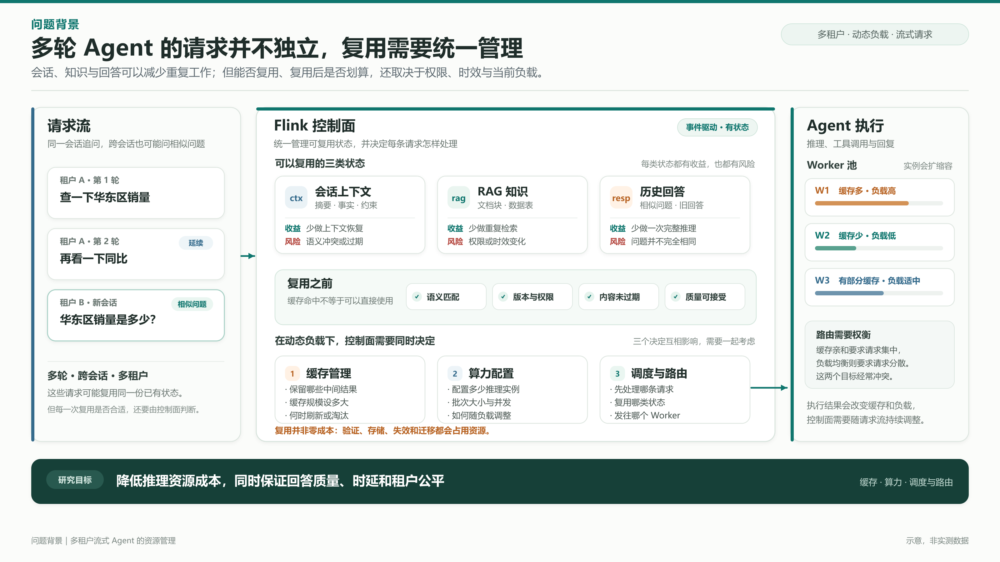
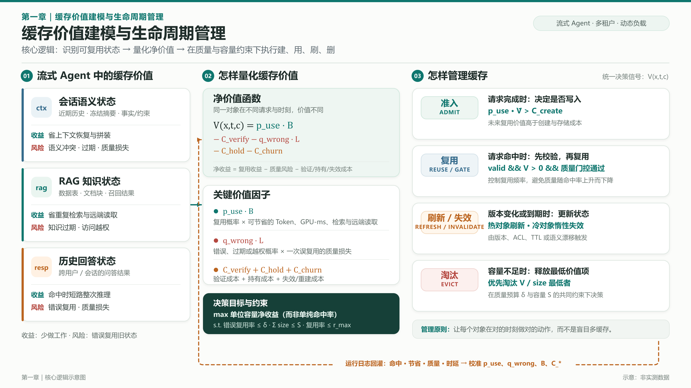

# 20261102大论文讨论

 

## 问题背景

Agent 应用的多轮会话并非相互独立的请求序列。对话摘要、事实记忆、RAG 文档和历史回答都可能跨轮甚至跨会话复用。观察到使用 Workbuddy 等 Agent 工具时，其会对每轮对话将消耗的成本进行预测，给出一个范围。对于上下文与语义都类似甚至完全一样的 Agent 请求，复用上下文、结果等可以减少远端读取、上下文恢复甚至完整的一次推理，但是这也引入了状态存储、语义验证、错误率控制等新的变量。

对于一个 Agent 服务，在动态多租户负载下，如何由 Flink 控制面统一管理 Agent 会话上下文语义、RAG 知识和历史问答三类状态？如何联合调优 Agent 运行参数，决定保留什么中间结果、配置多少缓存和算力？每个请求应先服务谁、采取何种复用动作、发送到哪个 Worker？回答这些问题才能在时延、质量和公平性的约束下降低推理资源成本，并获得更高的效率。

对流式 Agent 系统的高效资源管理与优化研究

- 缓存资源

- 算力资源

- 多租户调度与路由

目标场景：本工作适合于这样的 Agent 应用：

* 偏问答向 Agent，最终结果通常以图表、数值或文本的形式在对话回复中给出

* 通常不执行长程任务且不是在用户本地环境中执行任务，而是让 Agent 执行某些目的明确的云端任务

* 没有非常严格的 SLA 限制，对时延的约束较为宽松，更注重用户体验、结果质量与成本控制之间的权衡

* 由事件驱动的而不是定时触发任务或自主发起任务

* 例如查询某个业务数据（数据 Agent）、调研某个课题（调研 Agent）

## 大纲

### 1. 面向流式 Agent 系统的缓存价值建模与生命周期管理

要研究的问题：对于每种缓存对象，

* 缓存复用的收益和风险有哪些，如何计算

* 在什么条件下复用缓存

* 在什么时候需要更新缓存

* 以何种方式对缓存进行更新

* 如何把这些缓存对象以 Flink 状态的方式进行存取

* 为保证回复质量，需要把缓存复用的频率控制在一定阈值内。设计算法根据阈值反推缓存复用的频率（vCache ICLR '26）

* 要不要考虑缓存大小/数量限制

##### 缓存内容

| 状态类型            | 缓存对象                                             | 主要收益                 | 主要风险           |
|:------------------- |:---------------------------------------------------- |:------------------------ |:------------------ |
| 会话语义状态 `ctx`  | 近期会话历史、冻结摘要、结构化事实/约束              | 加速记忆读取、上下文拼装 | 语义冲突、质量损失 |
| RAG 知识状态 `rag`  | 召回的数据资产（例如数据表）、文档块、工具调用结果等 | 避免重复检索与远端召回   | 知识过期、访问越权 |
| 历史回答状态 `resp` | 跨用户/会话的全局历史回答                            | 安全命中时短路整次推理   | 错误复用           |

很多工作中都应用一个小参数模型作为 verifier 或者 validator

RAG 知识的复用分为两个部分

- 一是复用自然语言资产块，省掉检索查询召回的时间

- 二是复用检索块的 KV Cache，加速推理过程

**研究重点从“相似度阈值”转向“净复用价值 + 状态有效性 + 生命周期动作”**

Flink 中的状态是 KV 形式存储，那么缓存也比较适合用 KV 形式存储

#### 1.1 面向流式 Agent 系统的缓存价值建模

因子

- 当前请求与历史请求的相似度（语义、上下文）

- 未来窗口内被再次使用的概率

  - 不显式建模复用概率，而是用 1/T 近似：越久没有访问，越可能不再被访问，即 LRU 假设的连续化版本（Pensieve EuroSys '25）

  - 用 <1B 的模型作为语义判官，来判定“旧结果能不能回答新查询”，同时配置一个 expiration_time 确保未过期（Cortex NSDI '26）

- 该缓存的大小，例如上下文长度（Pensieve EuroSys '25）

- 缓存命中时可以节省的成本（先前记录的 Token、GPU-ms、检索调用）

- 避免缓存复用频率过高导致的质量下降，需要控制复用概率和复用阈值，从质量预期反推复用率（参考 vCache、Cortex）

不同的缓存复用动作

- 只复用 RAG 知识状态（Cortex NSDI '26）

- 只复用会话语义状态

- 只复用历史回答状态（Krites Arxiv '26 Apple）

- 复用会话语义状态、RAG 知识状态

#### 1.2 面向流式 Agent 系统的缓存生命周期管理

对于一条会话，要不要将其上下文、RAG 知识、历史回答写入缓存中

对于进入缓存的上下文、RAG 知识、历史回答，在什么条件、时间去触发更新

LCFU 缓存汰换策略（Cortex NSDI  '26）：先删除 TTL 过期项；超容量时按分数从低到高淘汰，直到用量不超过容量。意图不是最大化命中率，而是保留“更常用、回源更贵/更慢、更稳定、单位大小收益更高”的对象。

不判断“值不值得缓存”，默认缓存每个处理过的对象：cache everything, evict on pressure（Pensieve EuroSys '25）

#### 1.3 第一章参考文献

- vCache ICLR '26

  - 缓存正确性保障

- Cortex NSDI '26

  - 实验数据集可以参考使用，实验流程可以细看一下

- Pensieve EuroSys '25

- Krites Arxiv '26

  - 静/动态两层回答缓存，基于阈值判断是否命中缓存

  - 先查静态，未命中则差动态，仍未命中则调模型推理，并写入动态缓存

  - 灰色区间，给略低于静态阈值的 query 一次使用静态缓存的机会

    - 一次将静态缓存提升至动态缓存的机会（当前 query 复用类似 query 的回答）

- GenCache NIPS '26

  - 缓存的不是”答案“，而是”生成答案的程序“。对于同一个模板而参数不同的 Prompt，直接执行程序，按照新参数修改旧答案而生成新答案

  - 两层存储

    - Cluster Database（簇数据库）

      - 存储结构相似的 prompt-response 对

      - 负责”找同类“而非最终缓存

    - Cache Store（程序缓存）

      - 存的是每个簇对应的 program + structural regex

      - program：一个 Python 程序，输入新 prompt，输出符合该簇格式的 response

      - regex：描述**该簇 prompt 的结构模式**，用于运行时判断新 prompt 是否属于这个簇

      - 当程序在新请求上失败或下游反馈”负命中“，删除对应程序、保留簇，等待重新生成

  - CodeGenLLM 用簇内样例作为 in-context 示例，要求它归纳出“从 prompt 抽取参数 → 构造 response”的 Python 程序。程序通常用 regex 抽取关键词，再套回答模板，并包含异常处理；regex 不匹配时返回 `{null}`

- IC-Cache SOSP '25 与 GenCache 很类似

  - 把历史“请求—回答”对当作 in-context 示例，喂给更小的模型，让小模型模仿大模型的推理与格式。缓存命中不等于跳过推理，而是“用示例换模型档位”：把请求从小模型身上跑出大模型的质量

  - 实验中用到的 4 个开源用户请求数据集可以作为参考

  - proxy model

    - 解决的问题：**示例池很大，哪些示例真的对当前请求有帮助？**

    - 不回答用户问题，也不决定用哪个模型。它只回答：“如果把这条示例前置到当前请求里，小模型的最终回答会变好多少？”

  - request router

- APC NIPS '25

  - 缓存的是”计划“/”Plan“而不是 Agent 回复，抽出计划中可复用的结构，命中后按当前上下文适配，而不是直接复用旧输出

  - 新请求由轻量模型抽象一个能表达高层意图的关键词，缓存的就是（keyword, plan, template）对，按关键词精确匹配

    - 例：“compute the average of all numbers listed in an external document” → “mean calculation”

  - 把 Agent 执行日志压缩成“计划模板”，并且后续用关键词而不是语义相似度检索

    - 规则过滤器抽取关键信息，丢掉冗长推理

    - 轻量 LLM 过滤器去掉实体名、数值等上下文特定元素，得到泛化模板与关键词

    - 关注下为什么不用语义相似度，而是用关键词匹配：语义相似度会过度关注上下文细节，关键词更接近“是否会得到相似计划”，牺牲召回换精度，也避免模糊搜索的延迟

  - 命中后由小模型把模板适配成当前任务的计划，未命中才调用大模型重新规划

- KVFlow NIPS '25

  - 把 Agent 工作流看成一张已知的剧本（Planner -> Executor -> Reviewer -> Expressor -> Planner），给每个 Agent 算“还有几步轮到我”；越晚轮到的 KV 越先淘汰，越早轮到的越保留，并在当前 Agent 计算时提前把下一个 Agent 的 KV 搬进 GPU

  - 淘汰：按 `steps-to-execution` 排优先级；动态后缀先走；共享前缀取最近孩子；叶子到根淘汰

  - 预取：当前 Agent 计算时，提前把下一个/下一批 Agent 的 KV 从 CPU 搬到 GPU；分支处保守预取

  - 调度：感知 KV 状态：正在加载的请求先跳过；正在换出的节点不参与淘汰；预取与计算重叠

- SmartCache NIPS '25

  - 给多轮对话建一棵“话题树”，每个语义节点（query embedding, response, 子节点向量索引）是一轮问答，节点下面挂着它对应的 KV 块；查找时先定位话题，再在话题的子节点里找；多个会话可以共享语义节点，如果走到同一个语义节点，就共享同一批 KV，不复制

  - 关注的是两点

    - prefix cache 只匹配完全相同的 token 前缀，换个说法就 cache miss

    - 语义缓存容易忽略上下文，例如”怎么用它“可能匹配到错误的”它“

  - 会话进行中可能会换话题，因此可以在 prefill 时读取注意力分数，上下文相关的 query 对历史 token 的注意力明显更高而独立 query 的注意力更低。如果判定为独立 query，会话切换到另一棵语义树或新建树

  - KV Cache 的 block table 的优化，增加两层：

    - per-session context table：逻辑 token -> 上下文

    - per-context block table：上下文 -> 物理块

  - STEP 驱逐，按打分对语义节点进行驱逐

  - 预取，当会话推进到语义节点 N 时，按 N 的子节点的流行度（按公式计算）进行预取

  - 缓存 miss 时 LLM 正常生成，新语义节点加入森林；缓存命中时直接复用 response 和 KV 块

- Marconi MLSys '25

  - 不需要关注这篇工作的 SSM 状态

  - 区分两种可复用的前缀

    - 纯输入前缀

      - system prompt

      - 指令模板

      - few-shots 示例

      - 长文档

      - ......

    - 输入 + 输出前缀

      - 多轮会话历史

      - Agent 与环境的交互历史

      - 会话中不断追加的上下文

  - 缓存价值 = 未来复用概率 x 命中能省的计算（能省掉的 prefill FLOPS） / 占用的内存（KV Cache 字节数）

  - 淘汰策略综合考虑最近使用时间、缓存价值、前缀长度、是否被多个请求共享

  - 复用概率估计

    - 不用模型来预测，而是用树状结构，看是否已经被复用

    - 看是纯输入前缀还是输入+输出前缀

  - 可参考指标：token hit rate

- MemoryOS EMNLP '25

  - 借鉴操作系统把记忆分成短期、中期、长期三层：短期按 FIFO 队列滚动，中期按话题分段分页，长期保存用户/Agent 画像，并用 heat 分数决定提升与淘汰

  - STM，保存实时对话，单位是”对话页“ page_i = {Q_i, R_i, T_i}，分别代表这一轮对话的 query、response、时间戳

    - 对话链，先判断新页与前面页的上下文相关性，决定接到已有的链还是重置；再把链上所有页总结成 meta_chain，让 STM 不只是滑动窗口，还保留短期的上下文结构

    - 每个对话页带一个 meta_chain，是 LLM 对这条链上所有页面的上下文摘要

  - MTM，保存话题段（segment），每段由同一话题的多个对话页组成。MTM 用“分段分页”结构，段内再分页。段的内容是 LLM 基于该段内相关对话页总结出来的

    - 新页追加到 STM 的队尾，当STM 达到最大容量时，最老的页按 FIFO 移到 MTM 中，MTM 用相似度把页归入话题段

      - 相似度，把对话页和主题段分别算“向量语义余弦相似度”和“关键词 Jaccard 重合度”，两者相加，超过阈值就把这一页归入该段

        - 余弦相似度衡量”意思像不像“

        - Jaccard 衡量”关键词重合多少“

    - 热度，MTM 段的删除与向 LPM 的提升都用 heat

      - heat，把段被检索的次数、段内对话页的数量、以及按时间指数衰减的最近访问程度分别加权求和，得到段的热度，低热度段被淘汰，高热度段升入长期记忆

  - LPM，保存用户画像和 Agent 画像。用户侧包括静态 User Profile、动态 User KB、User Traits；Agent 侧包括 Agent Profile、Agent Traits

- RAGCache TOCS '25

  - RAG 的预填充被长文档拖慢，因此把每个文档的 KV 张量按检索顺序组织成知识树，并用前缀感知的 PGDSF 在 GPU/主机内存间做分层缓存

  - 知识树

    - 根节点是共享的 system prompt，每条根到叶的路径表示一个文档序列，节点保存该文档的 KV 张量地址

    - 不同请求的路径可以共享节点，前缀匹配沿路径向下，遇到不存在的子节点即停止

  - PGDSF 替换策略

    - 优先级 = 访问新近度 + 时间窗口内的检索此树 x 计算该文档的 KV 的时间 / 文档 token 数

  - 前缀感知的成本估计

    - 同一个文档在不同前缀下的重算成本不同。RAGCache 不用单次测量的成本，而是对“未缓存 token 的重算时间/新增 token 数”做多请求平均

    - 未缓存 token 的重算时间由离线 profiler 在不同”已缓存/未缓存 token 长度“下测得，再用双线性插值估计。

    - **这个 profiler 有点意思，可以作为参考**

      - 已缓存了 m 个 token，还有 n 个 token 需要计算，那么 T 就根据这两个 token 数计算

      - 只计算一些网格点（128，256，512...），其他点用双线性插值计算

  - 缓存感知重排

    - 在高请求率下，把共享前缀的请求排在一起，减少抖动同时保留公平性以避免饥饿

  - 动态推测流水线

    - 向量检索分阶段返回候选文档

    - 若候选发生变化且待处理请求数低于 `max_prefill_bs`，就提前启动一次推测生成

    - 最终结果一致则直接返回，否则丢弃并重算，论文用 G/G/1 队列给出最优策略的条件

- Cache-Craft SIGMOD '25

  - RAG 的块级 KV 缓存不能像前缀缓存那样直接拼接，Cache-Craft 用注意力统计判断“这个知识块的 KV 被外部上下文污染了多少”，只重算少量关键 token，并给缓存变体打上可复用性分数

  - 可复用性判定，判断这个块在旧上下文里算出的 KV，换到新上下文后还能不能用，如果不能用，需要修多少 token

    - CCI（Cache Context Impact）判断这个块有多依赖外部上下文

      - inter-attention：块内 token 对前缀块的累计注意力

      - intra-attention：块内 token 对块内前文的累计注意力

      - CCI 由这两个变量的逐层平均得到比值再由 sigmoid 归一化得到。CCI 高表示块高度依赖外部上下文，复用风险高；CCI 低表示块更“自包含”，更适合复用

    - 前缀重合度判断新旧上下文有多像

      - 只看 CCI 还不够，一个块即使很依赖前缀，只要新前缀和旧前缀几乎一样，也可以复用

        - 新旧前缀有哪些 chunk 重合

        - 重合的 chunk 顺序是否一致

        - 顺序不同会用归一化 Kendall τ 做惩罚，得到 `P_adj`

    - 合成 CFO，判断要修多少 token

      - CFO = 缩放系数 × CCI × (1 - P_adj)

  - 选择性重算

    - 选择对前缀注意力最高的 top-N 个 token 进行重算

  - 缓存变体

    - 同一个 chunk 可能在不同前缀下被反复使用，所以 Cache-Craft 允许一个 chunk 存多个 **变体**

      - chunk hash -> [变体 1, 变体 2, ...]

    - 新请求到来时，对每个候选变体算 CFO，选 **CFO 最低** 的那个，也就是“修复成本最低”的版本

    - 每次命中把该变体的 `frequency-reuse` 增加 `1/CFO`，缓存满时周期性驱逐该值最低的变体

- ContextPilot MLSys '26

  - 把检索到的上下文块重新排序、去重并加注释，让更多内容落在前缀缓存的命中路径上

  - 上下文检索（一棵记录“上下文块顺序”的目录树新请求和以前哪个请求共享最长的开头），用来快速找到新请求和以前哪个请求共享最长的开头

    - 每个节点保存：上下文块 ID 集合、从根到该节点的搜索路径、访问频次、创建时的聚类距离

    - 构建用层次聚类：先算上下文两两距离，反复合并最近的一对，生成一个“共享前缀”的虚拟节点

    - 不仅看共享文档数，还看共享文档的位置是否一致

  - 对齐： 对新请求，沿索引找到最长共享前缀，把匹配到的块放到前面，其余块保持原相对顺序

  - 调度：仅对齐还不够，执行顺序也会影响缓存。调度器按搜索路径的第一个元素分组，同组内按路径长度降序执行，让长前缀先进入缓存，避免短前缀把长前缀挤掉

  - 注释：重排会改变相关性顺序，可能触发 lost-in-the-middle。ContextPilot 在 prompt 中加入简短注释，说明原始相关性排序和去重块的位置，让模型按语义而非位置理解上下文

  - 去重：多轮对话中，重复块用位置注释替代，指向历史中的首次出现。细粒度重复用内容定义分块：在满足 `HASH(line) mod M = 0` 的行边界切分，保证插入/删除不会整体移位；相同子块用哈希识别，只保留首次出现

  - 索引更新：推理引擎驱逐缓存时，把 request ID 发给 ContextPilot；ContextPilot 通过 request→node 映射删除对应节点，并递归剪掉空父节点

- FreshCache Arxiv'26

  - 把开放网页 RAG 的缓存复用写成“过期概率是否低于预算”的决策，按答案、URL 列表、页面内容三层分别设误差预算。主要关注开放网页 RAG 的缓存

  - 新鲜度分类，查询分为五类，每类有不同的“半衰期”

  - 规则风险模型，内容过期概率按指数衰减

  - 学习风险模型，一个轻量 MLP 分类器，用来预测“给定这条缓存的内容类型、年龄、域名波动、答案类型等特征，它现在过期的概率是多少？”

    - 输入是 25 维特征

  - 复用判定，对每个候选条目，同时满足相似度阈值和风险预算才复用

- FinCacheServe Arxiv'26

  - 要解决的问题是：在企业文档会不断变化的前提下，历史答案还能不能安全复用？

  - 把生成答案当作“有依赖的 serving 对象”，只有财务意图、证据指纹、工具输出、模型配置和文档版本全部一致才允许复用

  - 缓存的不只是答案文本，而是一个条目

    - 答案

    - 请求签名

    - 源文档版本

    - 证据指纹

    - 工具指纹

    - 模型身份

    - 解码配置

    - 反向索引

  - 只有通过签名、证据、版本、工具/模型的所有校验后，才能命中缓存复用

  - 还有一个 document -> answer 的反向索引，filing 更新时先更新版本库，再通过反向索引使依赖该文档的答案条目失效，之后才允许读路径看到新版本

- MVR-Cache ICML '26

  - vCache 已经解决了“相似度如何转成有质量保证的命中决策”，MVR-cache 转而解决“相似度本身算得准不准”

  - 把输入相似度从“整句单向量余弦”换成“学习式分段 + 对称 MaxSim”。目标是在同一个错误率上界下，识别出更多真正可复用的回答

  - 把“整句用一个向量表示”改造成“按语义相关片段用多个向量表示”，让缓存检索更接近判断“旧回答能否回答新问题”，而不是只判断“主题是否相似”

    - 多向量不能随便切，因此训练轻量分段模型

      - 候选切分点主要来自标点符号

      - 模型选择其中一部分

      - 输出可变数量的连续片段

      - 对新 prompt 和缓存 prompt 使用同一套分段策略

    - 分段模型的作用是把决定“回答是否等价”的局部语义单元暴露出来，让匹配发生在更合适的粒度上

  - MaxSim 要对称化，避免单项覆盖

    - 这个可以看下对研究是否有用

  - 分段模型不直接优化命中率，而是优化回答等价性

    - 让分段后的 SMaxSim 与“两条 Prompt 的回答是否相同”这个标签对齐，这比“主题相似”更接近缓存真正关心的问题

    - 这一点也可以研究一下

  - 分段是离散动作，所以用 RL

    - 分段模型的输出是一个离散切分集合，可能的分段组合随 Prompt 长度指数增长，而且边界选择不可直接反向传播

- Semantic Caching INFOCOMM '26

  - 这篇工作的解决问题的逻辑可以参考一下

  - 语义缓存不是“相似就命中”，而是要在有限容量下选出一组最值得缓存的查询，并让每次请求在“复用旧答案的失配代价”和“重新调用 LLM 的成本”之间做最小代价选择

  - 传统缓存看命中率。语义缓存不同

    - 缓存命中不一定正确

    - 即使不完全相同，也可能可以复用

    - 但复用会产生 **失配代价** `d(q,M)`

  - 对于已知参数，Reverse Greedy

    - 解决的问题是容量只有 k，应该保留哪 k 个查询及其回答？

    - 从“全部查询都已经缓存”开始，每次删除一个“删掉以后损失增加最少”的查询，直到只剩 `k` 个

    - 这个损失怎么计算的可以看一下，对每个查询取回源成本 \(c(q)\) 与复用最近缓存的失配成本 \(d(q,\mathcal M)\) 的较小值，再按查询到达概率 \(p(q)\) 加权并对所有查询求和，即 \(\ell(\mathcal M)=\sum_q p(q)\min\{c(q),d(q,\mathcal M)\}\)

  - 真是系统通常不知道哪个查询经常出现、每次调用 LLM 到底多贵、哪些查询虽然被缓存，实际却很少回源。因此需要先离线学习

    - 因此先从历史日志估计参数

    - 所有请求都看得到查询，因此能估计到达概率

    - 只有真正调用 LLM 时才看到成本，因此成本反馈不完整

    - 离线算法采用偏保守的成本上界

  - 在线时边服务边学习

    - 不确定的查询先当成更便宜，增加真实调用机会，从而获得成本反馈

    - 不每轮重建缓存，而是积累足够观测后再切换。这样既能学习，又能把切换次数压到很低

- AgenticCache MLSys '26

  - 用异步缓存复用具身 Agent 的计划转移

    - 下一步计划通常可由当前计划预测

  - 缓存键设计

    - 用上一计划 + 当前状态过滤候选，用“局部频率 x 全局确认率”评分

    - 缓存结构化的计划片段、工具工作流，而不是完整回答或自由文本推理

    - 缓存键必须包含任务阶段、数据/工具版本、权限和状态摘要

  - 只对只读或可回滚步骤直接复用；有副作用操作需验证或确认

  - 补充 TTL、容量淘汰、版本失效和负反馈衰减

  - 异步刷新

    - 后台异步验证，在子目标完成等安全边界纠正，不中途打断不可逆动作

---

### 2. 动态负载下流式 Agent 系统算力配置和参数调优研究

推理时延在 Agent 执行过程的总时延中占据很大部分，给定一个推理时延的 SLA，需要调整推理配置以降低时延或降低成本

要研究的问题：面对变化的 Agent 请求负载（负载从 req/s 变成 step/s、token/s、tool-call/s），需要推理实例数量和批次大小（可以考虑替换成其他因素）来保持推理时延与推理成本之间的平衡

流式 Agent 系统中，Agent 算子不再是单纯的推理算子，而是一个完整的 Agent 执行算子，其中包括完整的 Agent 调用链（Agent Loop、推理、工具调用等），实际上 Flink Agents 项目正提供了一个这样的算子

问题及设想的解决方案

- 在 Agent 算子中，一条请求通常不止一次推理，这导致推理时延更加难以预测。并且之前仅在请求进入系统时预测一次推理时延的做法在这里的意义不大了

- 不再使用预测的方式，而是转为**反馈**的方式来进行配置调优。预测是不可靠的推断，归因是可观测的因果。只对当前耗时比例高、边际收益大的变量进行调优

  - GPU 排队占主导就加推理实例

  - 算子排队占主导就增加 Agent 算子实例

  - 工具占主导需要进一步判断瓶颈位置

    - Agent 侧工具并发不足则调整并发

    - MCP 接入层排队则增加 MCP 服务副本或连接池

    - 下游工具、API 或数据库限制，则采用限流、背压、缓存或与下游协同扩容

- SLA 从端到端时延改成进度型 SLA，即不去预测工具多久返回结果，而是约束“多长时间不能没有进展”

  - 还可以看达成率约束（统计窗口内，按时完成的请求占比不低于目标值）、成本归一化 goodput（单位时间内**达标**的有效工作量 / 单位时间使用的资源）

#### 2.1 流式 Agent 系统的负载度量与性能基线建模

负载度量：此时 Agent 系统到底承担了多少工作

Agent 的一次请求可能包含多步推理、多次工具调用和记忆读写，同样的 10 req/s，简单问答和深度调研的实际工作负载可能差一个数量级

#### 2.2 基于分阶段耗时归因的算力扩缩容与参数调优策略

对 Agent 算子进行扩缩容，使得系统能在动态负载下够满足 SLA，同时能使成本最低

---

### 3. 复用感知的多租户场景下流式 Agent 系统的调度与路由策略

要研究的问题：缓存亲和性要求请求集中到某个 Agent 算子、负载均衡要求请求分散到不同的 Agent 算子、租户公平性又要求不能一直优先服务容易命中缓存的请求。需要设计一套高效的流式 Agent 系统的调度与路由策略

#### 3.1 基于缓存复用的多租户流式 Agent系统的调度策略

结合第一章，对于多条 Agent 请求，综合考虑其用户信息（例如权限）、请求语义和当前的缓存状态等，计算此刻应先服务哪条请求，并采取不同的缓存复用策略

#### 3.2 配置约束下的多租户流式 Agent 系统路由策略

结合第二章，当 Agent 算子实例数量改变时，需要考虑路由到哪个实例，旧实例有前缀缓存，新实例则可以降低旧实例的负载，提升系统执行效率

粘性路由（缓存亲和）与最短路由（负载均衡）比较执行时间、推理成本，计算出当前最优的路由方案

---

### 记录

部分基于 Flink Agents （引入 Flink 原生的 Agent 算子）进行开发

* 多轮 Agent 会话应用基于 Flink Agents 开发，Flink Agents 只当作 Agent 应用框架和状态底座

* 缓存复用、流处理系统配置调优器、请求调度、路由器都作为独立算子/服务开发

* 推理服务作为独立于 Flink 系统，这样推理实例扩缩容不受 Flink 系统影响

Flink Compaction 与 Agent 记忆压缩是否可以结合？

根据请求已执行时长来决定先推理哪个请求。
