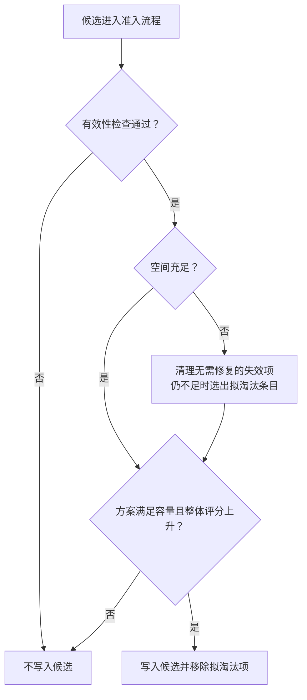
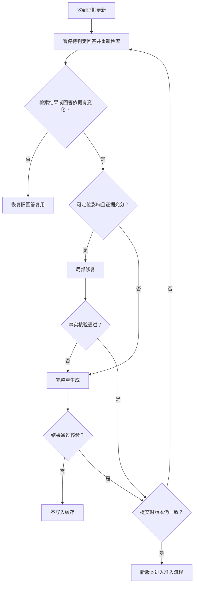

# 第一章 面向流式智能体的异质缓存机制与生命周期管理策略

> 改后初稿（第二版）。1.0 为绪论与相关工作预留素材（暂存，不进入本章正文）；本章导语按定稿位置预留（章标题下、1.1 前）；1.1 按重复计算与成本、异质对象分类、净收益判据、TTL 两难、信号错配、物化视图、两项核心难点、两个子问题、研究边界与符号说明的顺序重写；1.2 至 1.5 沿用第一版内容，参考文献按正文首次出现顺序重排。

## 1.0 绪论与相关工作预留素材（暂存，不放入本章正文）

> *注：本节内容从原 1.1 节中剥离，适用于论文整体第一章（绪论）的“研究背景与意义”及第二章（相关工作）的“智能体与大模型推理缓存研究现状”，在整理本章正文时可直接移出。*

### 1.0.1 流式智能体的范式演进与连续服务特征

在典型的单任务交互模式下，大语言模型智能体（LLM Agent）围绕单次用户请求依次执行“意图理解—任务规划—外部检索—工具调用—回答生成”的串行链路，请求结束后即丢弃执行过程中产生的检索证据、规划模板、工具结果与最终回答等中间产物。然而，在实际生产部署中，智能体越来越多地以**连续服务（Continuous Service）**形态运行，形成“流式智能体（Streaming Agent）”工作负载——系统持续接收交织到达的**用户任务流**与**外部内容更新流**。与单次离线的交互式调用相比，流式智能体运行环境呈现三方面显著差异：

1. **稳定的跨请求复用窗口**：在业务高峰或周期性任务场景下，高频查询、热点知识片段、固定工具查询与标准任务流程会在连续时间窗口内反复出现；
2. **事件驱动的外部状态演化**：底层知识库文档、离线数据分区表、业务规则与外部工具接口会随时间持续发生版本变更，导致历史中间产物的有效性随外部事件动态变化；
3. **持续积累的执行反馈记录**：连续运行过程中产生的命中记录、重算开销与错误回退信号为缓存价值的动态估计提供了可观测依据。

### 1.0.2 现有大模型与智能体缓存研究脉络及空白

现有面向大语言模型与智能体系统的缓存研究主要沿两条技术主线展开：

- **模型推理层 KV Cache 复用**[1,2,3]：聚焦于 Transformer 注意力计算中的键值张量复用，通过前缀共享、分层卸载与显存调度降低预填充（Prefill）与解码（Decode）阶段的计算与访存开销。此类方法严格依赖 token 级前缀匹配，无法覆盖工具调用、外部检索与高层规划等推理引擎之外的异质中间产物。
- **应用层语义回答缓存（Semantic Answer Cache）**[4,5]：通过向量相似度检索历史问答对，直接返回语义相近的历史回答以跳过完整的模型推理链路。此外，近期少量研究开始探索针对单一中间产物（如规划模板或检索块）的专用缓存机制[6,7,8]。

综合来看，现有工作存在两类互补的研究空白：**其一，缺乏面向异质对象的统一价值度量准则**，现有策略多依赖时间、频次或静态规则，未能围绕“未来预期净收益”对不同类型对象的复用收益与误用代价进行统一量化；**其二，缺乏面向内容持续演化的跨对象生命周期与依赖管理机制**，在外部来源更新时难以兼顾缓存一致性与重算开销控制。此外，工作负载的非平稳特性进一步放大了上述两类问题的求解难度。

## 本章导语（章首引言）

面向持续提供服务的流式智能体系统，单次请求往往串联任务规划、知识检索、工具调用与回答生成等多个高开销阶段，直接重复执行全链路会带来显著的响应延迟与推理成本。在用户任务流与外部更新流交织到达的运行环境中，如何对执行链路产生的多类异质中间产物实施高效缓存，并在内容持续演化时维持复用收益与结果正确性的平衡，是降低端到端开销的关键问题。针对上述需求，本章提出一种面向流式智能体的异质缓存机制与生命周期管理策略。

本章的组织结构如下：第 1.1 节分析流式智能体中的异质缓存复用特征、现有判定信号的结构性错配与核心研究问题，并给出本章主要符号定义；第 1.2 节构建面向多类异质对象的统一净收益价值模型与风险受控复用机制；第 1.3 节设计基于集合增益的准入淘汰调度策略，以及面向单轮 `rag → resp` 链路的依赖传播与缓存修复机制；第 1.4 节通过离线事件回放与真实请求标定实验对所提方法进行评测与分析；第 1.5 节总结本章工作。

## 1.1 问题背景与分析

在连续服务场景下，流式智能体需要持续处理交织到达的用户请求流与底层知识/数据更新流。研究表明，智能体执行链路中的重复计算具有高度集中性与高昂成本：在检索增强生成（RAG）负载中，约 \(3/4\) 的检索文本块在连续请求间重复出现[9]，外部检索环节可占据端到端响应时间的 \(40\%\text{--}50\%\)[10]；在复杂推理与任务编排场景下，FinanceBench 基准测试中规划阶段消耗了超过 \(90\%\) 的大语言模型调用开销[11]，而在具身智能体任务中，规划与重规划耗时更是占到总运行时间的 \(70\%\) 以上[12]。

> *[待补充：此处建议后续结合第 1.4 节评测集，补充一组本章自测的动机实验数据与柱状/折线图（图 1-1），直观展示不同阶段耗时占比及传统 TTL/LRU 策略在更新流冲击下的有效命中率与过期误用率对比。]*

与传统 Web 缓存或单一粒度的 KV Cache[1] 不同，流式智能体在单次请求执行链路中会产生多种语义层级、生成开销与失效规律迥异的中间产物。为便于后文统一建模，表 1-1 将流式智能体运行过程中的关键对象划分为四类可复用缓存对象与一类非复用依赖状态。

**表 1-1 流式智能体中的异质缓存对象分类与复用特征**

| 对象标识 | 对象类型         | 典型内容与作用                                   | 复用判定特征与演化敏感性                                                           |
|:-------- |:---------------- |:------------------------------------------------ |:---------------------------------------------------------------------------------- |
| `resp`   | 最终回答对象     | 面向用户查询生成的最终自然语言回答               | 语义相似度匹配；存在语义覆盖冗余，受上游检索证据版本变更的级联影响；高稳定性回答与动态回答在验证成本与驻留收益上存在分化 |
| `rag`    | 检索证据对象     | 从外部文档库召回的证据块集合                     | 强依赖底层文档来源版本；文档更新后易失效，但未变更来源的证据块可跨请求稳定复用     |
| `act`    | 工具调用结果对象 | 只读外部工具或结构化查询的返回结果               | 结构化参数精确匹配；单次调用常支撑下游多个推理步骤或工具链，误用会直接污染后续计算 |
| `plan`   | 任务规划模板对象 | 多步任务分解方案与执行路径模板                   | 面向结构相似的任务簇复用；复用价值高度依赖历史执行完成率与稳定性                   |
| `ctx`    | 上下文与依赖状态 | 会话状态、版本快照与跨对象血缘映射（不直接复用） | 记录对象间的依赖与版本边界，用于支撑有效性校验与更新传播，本身不作为复用候选       |

如表 1-1 所示，四类可复用对象在匹配粒度、生成代价与时效边界上存在本质差异[13,14]。在实际业务中，复用收益与误用代价往往源于同一机制：一旦复用发生误判（例如命中过期证据或错误回答），不仅无法节省开销，反而会引发下游重算、答案幻觉或结果污染。因此，缓存决策不能停留在“能否命中”：命中只说明存在可复用的候选，是否真正复用，还要看在给定未来时间窗口内，复用带来的预期开销节省是否高于其潜在的误用代价。

以典型的 T+1 离线分区表查询场景为例[15,16,17]：假设某业务数据表每日午夜 \(00{:}00\) 完成分区切换与数据更新，针对该表产生的 `rag`、`act`、`plan` 与 `resp` 缓存条目若采用静态生存时间（TTL）策略，将陷入两难困境——若设置 \(24\text{ h}\) 长 TTL，用户在 \(23{:}58\) 写入的旧分区结果会在次日 \(00{:}05\) 被继续命中，造成严重的过期数据误用；若为避免过期而将 TTL 缩短至 \(1\text{ h}\)，则在午夜更新后的 \(00{:}30\)，大量本可在全天稳定复用的有效缓存条目会被过早驱逐，导致频繁重算。上述案例表明，脱离外部演化信号与对象特性的静态策略无法同时兼顾高复用率与低误用风险。

TTL 两难只是时间信号失效的一个具体表现。更一般地，现有缓存系统通常依据时间衰减、访问频次、静态类型规则或局部置信度信号作出准入、命中与淘汰决策[2,4,18,19]。然而，将其直接迁移至流式智能体异质缓存场景时，上述信号与“最大化未来净收益”的系统目标之间存在结构性错配，具体对比如表 1-2 所示。

**表 1-2 现有缓存判定信号与流式智能体净收益目标的错配分析**

| 现有信号类别      | 典型代表方法                     | 隐含假设                                     | 在流式智能体场景下的结构性错配                                                                 |
|:----------------- |:-------------------------------- |:-------------------------------------------- |:---------------------------------------------------------------------------------------------- |
| 时间类信号        | 固定 TTL、LRU                    | 条目价值随时间单调衰减，且各对象失效周期均匀 | 无法刻画事件驱动的突发性更新（如午夜分区切换），易导致“更新前过早失效、更新后延迟过期”         |
| 频次类信号        | LFU、访问计数                    | 高频条目必然具有高缓存价值                   | 忽视不同对象间的重算代价差异与误用惩罚，易将低开销条目留在缓存而淘汰高开销的 `plan`/`act` 对象 |
| 静态类型规则      | 按对象类型固定优先级或配额       | 同类对象具有相近的复用收益与稳定性           | 忽略同类对象内部的语义覆盖冗余（如高度重叠的 `resp` 条目边际增益趋近于零[3,5]）与历史质量分化  |
| 局部学习/验证信号 | 单条目相似度阈值、独立置信度门控 | 各条目反馈样本充足且相互独立                 | 在新条目冷启动或文档版本更新后缺乏足够单条目历史样本，难以可靠估计误用风险并权衡重生成代价     |

进一步从数据演化与对象耦合视角看，流式智能体的异质缓存体系在结构上类似于数据库中的**物化视图（Materialized View）**维护问题，但约束更为严苛：一方面，大语言模型从检索证据生成最终回答的推导过程具有非唯一性，难以通过纯关系代数规则直接增量重算；另一方面，上游来源版本的局部更新会沿对象依赖链路向下游传导（例如 `rag` 证据更新导致依赖该证据的 `resp` 回答失效），而语义空间中相似回答的集合覆盖效应又使得缓存条目的边际价值并非简单线性可加[3,5]。

把上述线索合起来看：对象异质与信号错配使单条目的复用价值与误用风险难以准确度量，语义覆盖与跨对象演化耦合又放大了有限容量下的调度与一致性维护难度。因此，在有限缓存容量与外部内容持续演化的约束下，构建高效、可靠的异质缓存机制主要面临以下两项核心技术难点：

1. **多类型异质对象的统一净收益建模与稀疏反馈下的风险判定困难。** 四类对象在单次重算开销、预期复用次数与误用后果上相差悬殊，长期价值又分别受语义覆盖、来源版本、下游调用范围与执行稳定性等结构属性影响，难以在同一尺度上衡量未来净收益。与此同时，复用收益与误用风险共生：新入池或刚经历版本变更的条目缺少自身历史样本，按相似度放行容易引入高代价错误，保守拒绝又会错失本可复用的机会。如何在异质属性统一量化与稀疏反馈风险控制之间取得平衡，是价值评估与复用决策的首要难点。

2. **有限容量下的集合级收益优化与并发演化中的跨对象一致性维护困难。** 有限容量下，缓存集合的整体收益不是各条目价值的线性叠加：语义高度重叠的回答会造成边际覆盖衰减，不同回答在验证成本与驻留收益上也有明显分化，按单条目得分贪心排序难以逼近集合最优。另一方面，文档更新与用户请求在时间上交错，上游变更会沿“来源版本 \(\rightarrow\) 证据块 \(\rightarrow\) 回答事实表述”向下游传导；受生成过程非唯一性的限制，更新时若一律整条失效并重算，开销过高，若放任旧回答继续服务或并发写回，又会残留过期事实或造成版本覆盖。如何在控制重算代价的同时保证演化过程中的事实准确性与版本一致性，是生命周期管理的核心难点。

围绕上述两项难点，本章将研究问题凝练为两个紧密耦合的子问题：

- **子问题一（异质缓存价值建模与风险受控复用，对应第 1.2 节）**：如何面向 `resp`、`rag`、`act`、`plan` 四类异质对象，建立统一量纲的未来净收益估值模型与类型特定修正项，并在语义与结构召回、硬有效性校验的基础上，设计版本感知的簇内反馈借用与风险门控机制，以在稀疏反馈下实现收益与风险的可控权衡？
- **子问题二（集合增益生命周期调度与跨对象依赖维护，对应第 1.3 节）**：如何在有限容量约束下设计基于集合边际增益的统一准入/淘汰与分层晋升策略，并针对外部文档更新构建覆盖 `来源版本 → 证据块 → 回答事实表述` 的单轮 `rag → resp` 依赖追踪、选择性局部修复与版本条件提交机制？

**研究边界界定**：本章聚焦于应用层异质缓存的价值建模、复用风险控制与生命周期调度策略设计，通过标准化的估值信号与策略接口与底层推理引擎及存储系统解耦，不涉及大语言模型参数微调、推理引擎底层 KV Cache 算子改造或分布式存储内核修改；实验评测聚焦于离线事件回放与真实请求延迟/成本校准下的策略有效性验证，分布式在线流处理引擎部署与超大规模集群吞吐扩展不在本章讨论范围内。

为便于后文阐述，表 1-3 总结了本章核心建模与调度算法所使用的主要数学符号。

**表 1-3 本章主要符号说明**

| 符号                                                               | 含义说明                                                                                                                      |
|:------------------------------------------------------------------ |:----------------------------------------------------------------------------------------------------------------------------- |
| \(i, H\)                                                           | 候选缓存条目 \(i\) 及未来估值时间窗口长度 \(H\)                                                                               |
| \(V_{\mathrm{base}}(i, H)\)                                        | 条目 \(i\) 在窗口 \(H\) 内的基础预期净收益，\(V_{\mathrm{base}}(i,H)=\widehat{N}_i(H)\overline{\Delta t}_i-\widehat{F}_i(H)\) |
| \(\widehat{N}_i(H), \overline{\Delta t}_i, \widehat{F}_i(H)\)      | 条目 \(i\) 在窗口 \(H\) 内的预期复用次数、单次复用平均节省开销及预期误用代价                                                  |
| \(V_{\mathrm{final}}, T_{\mathrm{ref}}, \Delta S_{\mathrm{type}}\) | 归一化后的最终综合价值、参考时间归一化因子及类型特定价值修正项                                                                |
| \(d_i, q_i\)                                                       | `act` 对象关联的下游工具调用数量 \(d_i\)；`plan` 对象的历史平滑完成率 \(q_i\)                                                 |
| \(\widehat{p}_i, p_c, m\)                                          | 经簇内反馈借用平滑后的条目误用风险估计 \(\widehat{p}_i\)、同簇先验误用率 \(p_c\) 及平滑先验权重 \(m\)                         |
| \(e_i, n_i\)                                                       | 条目 \(i\) 在当前版本下的历史错误次数 \(e_i\) 与总复用观测次数 \(n_i\)                                                        |
| \(\delta, \varepsilon\)                                            | 风险门控重生成机制中的置信容忍参数与风险上界阈值                                                                              |
| \(M, E, \Delta S\)                                                 | 当前缓存集合 \(M\)、拟淘汰条目集合 \(E\) 及引入条目 \(i\) 后的集合边际增益 \(\Delta S = S((M\setminus E)\cup\{i\},H)-S(M,H)\) |

## 1.2 基于异质中间结果价值建模与有效性检查的缓存机制

> 研究点一。本节内容待对齐后填写。

### 1.2.1 面向流式智能体的异质缓存价值建模

本节先以预计节省的用户等待时间衡量四类对象共有的基础缓存价值，再分别考虑回答的新增覆盖、证据的来源版本、工具结果的下游支撑范围和计划的执行质量。以净收益衡量复用价值、按成本感知方式管理缓存的思路见文献[5,10]。

**（1）基础缓存价值。** 设当前时刻起的估值窗口长度为 \(H\)，缓存条目 \(i\) 的基础价值为：

$$
V_{\mathrm{base}}(i,H)=\widehat{N}_{i}(H)\,\overline{\Delta t}_{i}-\widehat{F}_{i}(H).
$$

- **预计有效复用次数 \(\widehat{N}_{i}(H)\)**：根据近期滑动窗口内的相容需求、条目的剩余有效期及历史选用情况估计。需求统计覆盖已复用和经正常执行满足的相容请求或执行步骤。
- **单次复用净节省 \(\overline{\Delta t}_{i}\)**：用正常执行的平均耗时减去成功复用的平均耗时。成功路径计入缓存读取、有效性检查以及必要的补检或适配。
- **失败尝试的额外开销 \(\widehat{F}_{i}(H)\)**：用预计失败次数乘以平均额外耗时。额外耗时是“尝试后回退”的总耗时减去“直接正常执行”的耗时。例如，检查工具结果用时 30 ms，发现过期后调用工具用时 200 ms，而直接调用用时 200 ms，则额外开销为 30 ms。尝试前已排除的候选不产生此项开销。

**（2）类型专属价值。** 回答和证据的专属价值用于校正基础估值，工具结果和计划的专属价值分别反映依赖结构和执行质量。

| 缓存对象              | 类型专属价值               | 计算思路                                                                                                                                                                                                                                           |
| --------------------- | -------------------------- | -------------------------------------------------------------------------------------------------------------------------------------------------------------------------------------------------------------------------------------------------- |
| `resp` 回答           | 边际覆盖价值               | 对同一批近期请求回放有、无该条目的两种情况，比较该回答新增的安全复用机会及其耗时节省。已有缓存能提供同等服务时，该请求的增量为零。                                                                                                                 |
| `rag` 检索证据        | 来源版本感知的证据复用价值 | 按来源统计近期请求实际采用的证据，同一请求用到多个来源时，将一次机会分摊给这些来源。再按各来源当前版本在估值窗口内预计仍有效的时长加权，修正集合的未来复用机会。来源更新时，折减该版本对应的机会，其他来源可继续贡献。补检耗时计入单次复用净节省。 |
| `act` 只读工具结果    | 下游调用支撑价值           | 对每条结果，统计直接使用过其输出字段的不同下游工具数，同一工具重复使用只计一次。优先根据参数绑定记录确认字段来源；缺少绑定记录时，结合调用先后、字段含义和参数值推断。                                                                             |
| `plan` 计划模板或片段 | 计划执行质量价值           | 根据复用该计划后的执行日志计算顺利完成率：成功完成且未发生返工、回退或重新规划的次数，除以使用该计划进入执行阶段的总次数。同时记录任务完成率和平均调整次数，分别反映完成情况和执行稳定性。                                                         |

四类专属价值的建模分别借鉴：回答缓存的逐条目风险与覆盖[4]、证据缓存的来源稳定性与新鲜度[10,17,19]、工具结果的状态依赖[6]、计划模板的适配与执行反馈[7,11]。

**`resp` 的 LLM 辅助分簇。** 按 `resp` 条目对应的请求需求分簇。系统借助 LLM 提取请求意图、关键实体、时间范围和限定条件，将表述不同但回答需求一致的请求归入同一簇，并将缓存回答关联到其原始请求所在的簇。滑动窗口内各簇的请求频次用于估计潜在复用需求；估计边际覆盖价值时，从对应簇抽取近期请求，回放有、无该回答两种情况。当前请求能否复用该回答，仍由 1.2.2 的有效性检查决定。请求意图规范化与簇划分可参考文献[20]。

**（3）最终缓存价值与决策依据。** 将基础价值换算为无量纲分数，再结合各类对象的专属价值计算最终评分：

$$
V_{\mathrm{final}}(i,H)=\frac{V_{\mathrm{base}}(i,H)}{T_{\mathrm{ref}}}+\Delta S_{\mathrm{type}}(i,H),
$$

其中，\(T_{\mathrm{ref}}>0\) 为同一估值窗口下四类对象共用的参考时长。专属修正分 \(\Delta S_{\mathrm{type}}\) 按对象计算：

| 缓存对象 | 专属修正分                                                 | 计算方法                                                                        |
| -------- | ---------------------------------------------------------- | ------------------------------------------------------------------------------- |
| `resp`   | \((V_{\mathrm{resp}}-V_{\mathrm{base}})/T_{\mathrm{ref}}\) | \(V_{\mathrm{resp}}\) 为回放有、无该条目两种情况所得的边际净节省。              |
| `rag`    | \((V_{\mathrm{rag}}-V_{\mathrm{base}})/T_{\mathrm{ref}}\)  | \(V_{\mathrm{rag}}\) 为将来源版本校正后的有效复用次数代入基础公式所得的净节省。 |
| `act`    | \(w_{\mathrm{act}}\min(d_i/D_{\mathrm{ref}},1)\)           | \(d_i\) 是该结果直接支撑的不同下游工具数，\(D_{\mathrm{ref}}>0\) 为归一化上限。 |
| `plan`   | \(w_{\mathrm{plan}}q_i\)                                   | \(q_i\in[0,1]\) 是该计划的顺利完成率，执行样本不足时可参考同类计划的统计。      |

\(w_{\mathrm{act}}\) 和 \(w_{\mathrm{plan}}\) 为正权重，分别表示下游支撑范围和计划执行质量在决策中的重要程度。参考时长、归一化上限和权重在验证阶段确定，正式评估时固定。最终评分用于准入、保留与淘汰，预计耗时节省单独报告；缓存容量作为 1.3.1 的决策约束。

请求到达和执行反馈推动滑动窗口内的估计更新；证据版本或工具依赖状态变化时，重新评估受影响条目的有效复用机会。由此得到的估值供 1.3.1 的准入、保留和淘汰使用，当前请求是否可以复用则由 1.2.2 的有效性检查决定。

### 1.2.2 基于语义与结构匹配的缓存检索与有效性检查

上一节估计缓存条目的价值，本节判断候选条目能否用于当前请求。流式智能体在回答生成、知识检索、工具调用和任务规划阶段产生不同的复用需求。为此，本节采用统一的在线流程：**按对象召回候选 → 检查候选的当前有效性 → 复用或执行原流程 → 记录反馈**。

**（1）结合语义与结构匹配召回候选。** 语义匹配用于召回表述不同但需求相近的请求、证据或计划（多向量细粒度匹配见文献[21]）；结构匹配利用工具、参数、任务阶段等字段缩小候选范围。四类对象按各自的复用粒度建立索引，检索只返回少量候选。

| 缓存对象              | 候选检索                                                                                                             | 有效性检查与处理                                                                                                                       |
| --------------------- | -------------------------------------------------------------------------------------------------------------------- | -------------------------------------------------------------------------------------------------------------------------------------- |
| `resp` 完整回答       | 优先查找规范化请求的精确键；没有可用精确候选时，按问题语义片段召回少量历史回答。                                     | 检查权限、上下文、关键实体、时间范围和限定条件，以及回答所依赖的证据版本。语义候选通过这些检查后，再以条目级风险判定回答能否直接复用。 |
| `rag` 检索证据        | 一次检索获得的证据集合为基本缓存单位。按当前问题或子需求，对证据块进行关键词和语义检索，并记录候选块所属的证据集合。 | 逐块检查权限、来源版本和时效，再判断有效证据能否覆盖当前问题。覆盖充分时用于生成；能明确定位缺失项时补检；覆盖无法确认时执行完整检索。 |
| `act` 只读工具结果    | 用工具标识、工具版本、规范化参数和数据访问范围组成调用签名，做精确匹配。                                             | 检查权限及结果依赖的数据状态；状态仍有效时复用，否则重新调用工具。                                                                     |
| `plan` 计划模板或片段 | 按任务阶段和工具需求缩小范围，再按关键词和任务目标的语义召回 plan 或模板。                                           | 绑定当前任务的参数，检查前置条件、所需工具的可用性及权限；适配后满足条件时使用，否则重新规划。                                         |

四类对象的检索与有效性检查分别参考：回答的语义召回与风险门控[4,21,22]、证据块索引与新鲜度核验[3,19]、工具调用签名与状态检查[6,10]、计划模板检索与适配[11,12,23]。

**`act` 的复用边界与幂等扩展。** 跨请求结果复用限于只读工具。幂等工具可按两种方式扩展：同一业务操作的重试，按业务操作 ID 查执行台账，已成功则直接返回记录结果；以达成固定状态为目的的操作（如定值写入、确保资源存在），先检查目标状态仍成立再跳过执行，检查开销计入复用成本。参数相同的不同业务操作须各自执行，幂等性本身不作为跳过一次新业务动作的依据。权限隔离与缓存投毒等安全边界参见文献[24,25]，作为硬有效性门槛的设计参考。

**（2）基于版本感知的簇内反馈判断回答能否复用。** 语义候选先检查权限、请求条件和证据版本，通过后才估计误复用风险。借鉴 vCache 的逐条目在线风险估计[4]，系统按回答条目、版本和相似度区间积累反馈，再根据风险决定重生成概率；响应侧的安全复用判断另见文献[22]。

- **新版本反馈不足时，有限借用同簇反馈。** 利用 1.2.1 的 LLM 请求簇，只从同簇其他条目借用同一相似度区间、权限范围相容且相关证据版本一致的近期标注。设候选当前版本有 \(n_i\) 条自身标注，其中 \(e_i\) 条不匹配；同簇反馈的不匹配比例为 \(p_c\)，借用的等效样本数为 \(m\)，取可借用样本数与预设上限的较小值。风险估计为：

  $$
  \widehat p_i=\frac{e_i+m p_c}{n_i+m}.
  $$

  无兼容反馈时取 \(m=0\)，自身标注越多，借用占比 \(m/(n_i+m)\) 越小。合计样本量未达到最低要求时，走正常生成。证据更新产生新回答版本后，从新版本开始累计自身反馈。

- **按风险随机选择复用或生成。** 样本量达标后，设 \(\delta\) 为误复用风险目标，\(\varepsilon\) 为最低抽样概率。当 \(\widehat p_i\le\delta\) 时，以概率 \(\varepsilon\) 正常生成；当 \(\widehat p_i>\delta\) 时，以概率 \(\max\{\varepsilon,1-\delta/\widehat p_i\}\) 正常生成，其余情况直接复用。正常生成时先返回新回答，再由轻量 LLM 根据当前问题、可用证据和新回答，判断通过前置检查的旧候选是否答错、漏答或违反约束；判定明确时，将结果记入该候选的条目版本及相似度区间。

风险目标用于计算重生成概率，实际误复用率通过流式回放测量。固定检索、判官与决策规则，对比启用和关闭簇内借用，观察证据更新后在相近误复用率下，有效命中能否更快恢复，并记录用户端时延。

**（3）在实际使用前核对依赖状态。** 流式更新可能与候选检索交错。即使条目已被召回，实际使用前也要以系统当前已接收的版本状态为准。若此时收到来源更新，`rag` 剔除受影响的旧证据块，再判断是否需要补检；依赖该来源且已失效的 `resp` 回答退出本次复用。系统记录实际采用的条目、检查结果和耗时，为 1.2.1 更新价值估计；更新事件影响哪些缓存及如何修复，由 1.3.2 处理。

## 1.3 基于价值决策与依赖感知的缓存生命周期管理策略

> 研究点二。本节内容待对齐后填写。

### 1.3.1 基于缓存价值的分层准入与淘汰机制

本节将 1.2.1 的缓存评分用于准入、保留和淘汰。四类缓存共用价值决策；回答缓存 `resp` 另设静态层和动态层，验证通过的静态回答也可申请进入动态层。

**（1）四类缓存共用的准入与淘汰。**

- **准入：** 新结果先按对象类型检查权限、版本、时效和适用条件。空间充足时，加入候选能提高缓存整体评分才准入。已有回答能为同一批请求提供同等服务时，这部分收益不重复计入。
- **淘汰：** 空间不足时，先清理已失效且无需修复的条目。仍缺空间时，按“移除造成的评分损失 ÷ 释放的空间”从低到高选出一组拟淘汰条目，直到能容纳候选；再比较替换前后的整体评分。空间满足要求且评分上升时，才执行替换。成本感知淘汰[10]、带失配代价的集合优化[5]与依赖感知淘汰[26]可作对照。
- **保留：** 用近期请求和实际复用反馈更新评分，调整有效条目的保留顺序。依赖更新导致的失效与修复由 1.3.2 处理，修复后的新版本通过检查后重新参与准入。

设当前有效缓存集合为 \(M\)，候选条目为 \(i\)，拟淘汰集合为 \(E\)（空间充足时为空）。在同一估值窗口 \(H\) 内，比较：

$$
\Delta S=S\bigl((M\setminus E)\cup\{i\},H\bigr)-S(M,H).
$$

集合评分 \(S\) 沿用 1.2.1 的评分口径，在同一批代表性请求上评估两种缓存配置：同一次请求中实际避免的工作只计一次，再按 1.2.1 的权重计入工具结果的下游支撑和计划的执行质量。以 \(\Delta S>0\) 作为写入或替换的价值条件，缓存容量单独约束。

*图：四类缓存共用的准入与淘汰流程。*

**（2）`resp` 的静态层与动态层提升。** 参考 Krites 的双层回答缓存与异步验证思路[18]，两层分别保存：

| 层级   | 保存内容                                                             |
| ------ | -------------------------------------------------------------------- |
| 静态层 | 离线筛选的完整回答。                                                 |
| 动态层 | 按本节规则准入的在线回答，以及已验证的请求签名到静态回答版本的映射。 |

1. **先完成当前请求。** 静态回答满足 1.2.2 的复用条件时可直接返回；若相关但适用性暂不能确认，当前请求继续查动态层，未命中则正常生成。
2. **再验证静态候选。** 当前请求完成后，对已通过权限、时效和版本初检的静态候选，使用轻量 LLM 判断它是否满足本次请求；有可比的新回答时，可一并作为参考。
3. **通过后重新估值。** 写入前复核依赖版本，按通用规则比较新增映射的价值与占用空间。满足条件时写入动态层，映射绑定已验证的请求条件、权限范围和依赖版本；后续请求仍按 1.2.2 检查。

### 1.3.2 面向流式更新的依赖传播与缓存修复策略

RAG 依赖的外部资料会随时间新增、修改或删除，这些变更以更新事件的形式持续进入流式智能体系统，形成证据更新流。更新事件可能在系统处理请求或修复缓存时到达，因此，证据更新与请求处理、缓存修复会在时间上交错。本节聚焦单轮 `rag → resp` 的短回答，依次完成**记录依赖、定位影响、选择修复方式、核验写回**，使缓存回答与系统当前已知的证据版本一致。可变文档上的依赖一致答案复用见文献[16]，新鲜度风险与刷新调度对陈旧的影响见文献[17,27]。

**（1）生成时记录事实与证据的依赖。** 缓存回答时保存原问题、检索配置、索引版本和 Top-k 证据，并记录“**来源版本 → 证据块 → 回答中的事实表述**”的依赖关系。借助反向索引，系统能从变更证据定位到受影响的回答及具体表述；证据与表述的对应关系不清时，该回答走完整重生成路径。依赖感知的失效传播参考多智能体缓存的 DAG 依赖建模[26]与可变文档答案复用[16]。

**（2）更新时定位影响并暂停旧回答复用。** 收到证据新增、修改或删除事件后，先暂停尚未判定影响的缓存回答。首版用固定的确定性检索器对缓存查询完整重检，对比新旧 Top-k 的证据 ID、内容版本或哈希及排序。这样也能发现新进入 Top-k 的证据。检索结果与回答依据均未变化时恢复复用；发生变化时，把证据差异与依赖记录结合起来，定位受影响的表述。

**（3）根据影响范围选择局部修复或完整重生成。** 将原问题、旧回答、证据变更及更新后的相关证据交给轻量 LLM，判断影响范围并提出修复候选（证据驱动的文本修订参考 RARR[28]）：

| 条件                                                     | 处理方式                                           |
| -------------------------------------------------------- | -------------------------------------------------- |
| 影响限于可定位的事实，替代证据充分，其余表述仍有证据支持 | 只修改受影响的表述。                               |
| 影响范围不清、整体推理发生变化、溯源不清或缺少充分证据   | 基于最新证据完整重生成；仍无法确认时说明证据不足。 |

**（4）核验回答，再按版本条件写回。** 逐条核验候选回答中的事实，包括修改和保留的表述（细粒度主张核验与幻觉标注参考 RAGTruth[29]）。局部修复未通过核验时，回退到完整重生成。提交时复核任务绑定的索引版本和来源版本；若修复期间又收到相关更新，丢弃旧候选，按最新版本重新定位。通过核验且版本仍一致的结果，连同新依赖记录进入 1.3.1 的准入流程；待修复的旧回答保持不可复用。

*图：证据更新后的影响定位、修复与版本条件提交。*

例如，活动公告将开始时间从 **10:00 改为 10:30**，地点和入场规则的依据仍有效，系统只修改时间，再核验整条回答。若提交前公告又改为 **11:00**，10:30 的修复结果作废，系统按最新证据重新处理。

该方法与完整重生成、轻量 LLM 直接改写的对比见 1.4.5。

## 1.4 实验评估与分析

本章实验围绕四条结论组织：每个实验检验一条，四个实验共用同一实验台、同一请求序列与同一成本表。实验一在质量约束下比较复用决策，实验二在容量受限下比较保留策略，实验三比较知识更新后的修复代价，实验四比较整体收益。

### 1.4.1 实验设置

**（1）离线回放与实测标定。** 实验在事件回放器上进行，按处理时间回放请求、证据更新与任务完成三类事件[30]。“不用缓存会怎样”这一反事实对任何策略都相同，因此预先算好一次，把执行分成两部分：

- **离线回放**：预先计算每条请求的无缓存生成结果、每条候选的判官标签与各项单价，形成标签表；各策略在这张表上回放，策略对比阶段不产生模型调用。
- **实测标定**：抽取 300 条请求真实执行，标定单价表，并报告建模时延相对实测时延的偏差（MAPE）。

全量结果报建模时延，正文同时给出 MAPE，说明其可信区间。

**（2）数据与规模。** 单场景受控实验台：2–3 千篇带版本文档、3,000 条单轮短请求、40 个更新事件；四类对象共用同一时钟，其中 `act` 为 50 个只读状态查询、`plan` 为 30 个模板。真值不依赖判官：`resp` 由检索相关性与版本重算确定，`act` 由规则引擎给出，`plan` 对照金标序列；工具与任务环境参考 AgentBench[31]、WebArena[32]、ToolBench[33]、StableToolBench[34] 与 WebShop[35] 的公开任务与沙箱接口。候选与标签表约 15,000 行。判官只用于风险估计与主张核验，其与人工标注的一致率单独报告。

**（3）指标。** 只报用户可见的结果，不报预测精度一类中间指标。

| 指标       | 定义                                      |
| ---------- | ----------------------------------------- |
| 回答正确率 | 判定为正确的回答数除以总回答数            |
| 质量约束   | 相对无缓存基线的正确率下降（百分点）      |
| P95 时延   | 单请求端到端时延的 95 分位                |
| 推理成本   | token、调用次数与后台时间按同一单价表折算 |
| 安全复用   | 命中且质量达标的请求数除以总请求数        |
| 修复成本   | 检索、生成与核验三项之和                  |
| goodput    | 满足质量与 SLO 的请求数除以单位时间       |

**（4）边界。** 不做扩展性与跨硬件实验；不做 Flink 真实部署，仅借用其状态管理接口；不单独做参数敏感性分析，实验一的前沿已覆盖风险目标；不与已有工作报告数字直接对齐，只做趋势比较。越权与过期复用次数作为硬断言报告，要求为零。

### 1.4.2 预期结论

四条结论与四个实验一一对应，式中字母为待实测数字。

- **C1 复用决策。** 在回答正确率相对无缓存下降不超过 1 个百分点的约束下，相比按固定阈值和 vCache 复现的逐条目风险门控，本文将 P95 时延降低 \(a\%\)、推理成本降低 \(b\%\)；在 1、3、5 个百分点三个约束点上，本文前沿始终位于基线左上方。
- **C2 容量受限。** 在同一有效性门槛与同一缓存容量下，相比 LRU、LFU、GDSF，本文分别多 \(x\%\)、\(y\%\)、\(z\%\) 的安全复用，P95 时延降低 \(c\%\)、成本降低 \(d\%\)。
- **C3 更新与修复。** 相比完整重生成，本文的选择性修复将修复成本降低 \(Z\%\)（检索降低 \(r\%\)、生成降低 \(g\%\)）、修复期 P95 时延降低 \(s\%\)，事实正确率与证据支持率不降；相比 LLM 直接改写，成本仅高 \(e\%\)，正确率高 \(w\) 个百分点。
- **C4 整体收益。** 相比任何单一机制，完整系统的 goodput 提升 \(u\%\)、总成本降低 \(v\%\)、正确率不降。

### 1.4.3 实验一：复用决策（C1）

检验复用决策能否在质量约束下取得更多收益。质量约束取 1、3、5 个百分点三点，每点下为各策略选择其最优配置，得到一条前沿。

| 项   | 内容                                                         |
| ---- | ------------------------------------------------------------ |
| 对比 | 全局相似度阈值（单点）、按 vCache 复现的逐条目风险门控、本文 |
| 指标 | P95 时延、推理成本、回答正确率、安全复用                     |
| 主图 | 质量-时延前沿（本文整条位于左上方）；去簇内借用的消融柱状    |

共 3,000 请求、3 个策略、3 个约束点，由离线回放完成。另单列更新后的 500 条请求，观察新版本标注稀少时命中恢复的速度——这是簇内借用唯一显形的条件；`act` 与 `plan` 在同一批请求上以任务成功率与时延小表报告。

### 1.4.4 实验二：容量受限（C2）

检验容量不足时保留决策的质量。容量取工作集的 10%、25%、50% 三点。四类策略共用同一候选集、同一硬门槛与同一成本表，差异只在保留决策。

| 项   | 内容                                       |
| ---- | ------------------------------------------ |
| 对比 | LRU、LFU、GDSF、本文                       |
| 指标 | 安全复用、P95 时延、累计成本、准入淘汰抖动 |
| 主图 | 容量-收益曲线；`resp` 静态层开关的结果对比 |

容量单位在设置中固定：`resp` 计 1，`rag` 按证据块数计，`act` 与 `plan` 各计 1。

### 1.4.5 实验三：更新与修复（C3）

检验知识更新后的修复代价。更新率取每千请求 5、20、50 个事件三点，事件类型与构造方式参考 ChurnBench[27]。

| 项   | 内容                                                                            |
| ---- | ------------------------------------------------------------------------------- |
| 对比 | 完整重生成、LLM 直接改写、本文依赖定位修复                                      |
| 指标 | 修复成本（检索/生成/核验分解）、修复期 P95 时延、事实正确率、证据支持率、回退率 |
| 主图 | 质量-成本散点；成本分解堆叠柱                                                   |

共 40 个事件、约 1,600 条受影响回答、3 种方式。理想结果是本文落在完整重生成的正下方、直接改写的正右方：质量贴着重生成，成本贴着直改。回退率说明成本优势在何种条件下收窄。

### 1.4.6 实验四：整体收益（C4）

检验完整系统相对单一机制的整体收益，在含更新事件的混合负载上比较四个配置。

| 项   | 内容                                               |
| ---- | -------------------------------------------------- |
| 对比 | 无缓存、最强单一机制、完整系统、去掉单项的完整系统 |
| 指标 | goodput、P95 时延、总成本、回答正确率              |
| 主图 | 分组柱状；更新事件前后各 30 分钟的时序曲线         |

去掉单项分别检验 `act`/`plan` 价值项、依赖修复与簇内借用的边际贡献。

### 1.4.7 结果讨论

讨论三类情形：收益收窄的条件（容量极小时价值决策退化、更新率过高时回退率上升、请求重复度低时命中不足）；建模时延与实测时延的偏差来源；构造数据的边界（到达过程、重复与更新事件为构造，真值来源与偏差在数据卡中声明）。

## 1.5 本章小结

> 待对齐后填写。

## 参考文献

下列文献按正文引用顺序编号；预印本已标注，出处以正式发表版本为准。详细书目与使用位置见《第一章_参考文献汇总.xlsx》。

[1] Gao B, He Z, Sharma P, et al. Cost-Efficient Large Language Model Serving for Multi-turn Conversations with CachedAttention[C]//Proceedings of the 2024 USENIX Annual Technical Conference (ATC). 2024.

[2] Pan Z, Patel A, Hu Z, et al. KVFlow: Efficient Prefix Caching for Accelerating LLM-Based Multi-Agent Workflows[C]//Advances in Neural Information Processing Systems 38 (NeurIPS). 2025. arXiv:2507.07400.

[3] Jin C, Zhang Z, Jiang X, et al. RAGCache: Efficient Knowledge Caching for Retrieval-Augmented Generation[J]. ACM Transactions on Computer Systems, 2026, 44(1): 1-27. DOI: 10.1145/3768628.

[4] Schroeder L G, Desai A, Cuadron A, et al. vCache: Verified Semantic Prompt Caching[C]//International Conference on Learning Representations (ICLR). 2026. arXiv:2502.03771. https://iclr.cc/virtual/2026/poster/10006471.

[5] Liu X, Atalar B, Dai X, et al. Semantic Caching for Low-Cost LLM Serving: From Offline Learning to Online Adaptation[C]//IEEE INFOCOM 2026—IEEE Conference on Computer Communications. IEEE, 2026: 1-10. DOI: 10.1109/INFOCOM59046.2026.11571467.

[6] Kumar A V, Kataria B, Oh B, et al. TVCACHE: A Tool-Value Cache for Post-Training LLM Agents[C]//Proceedings of the 43rd International Conference on Machine Learning. PMLR, 2026, 306: 61539-61558. https://proceedings.mlr.press/v306/kumar26d.html.

[7] Fan S, Cong X, Zhang Z, et al. Generalizing Experience for Language Agents with Hierarchical MetaFlows[C]//Advances in Neural Information Processing Systems 38 (NeurIPS). 2025. https://proceedings.neurips.cc/paper_files/paper/2025/hash/5c882988ce5fac487974ee4f415b96a9-Abstract-Conference.html.

[8] Begum F, Scott C, Nyarko K, et al. Hierarchical Caching for Agentic Workflows: A Multi-Level Architecture to Reduce Tool Execution Overhead[J]. Machine Learning and Knowledge Extraction, 2026, 8(2): 30. DOI: 10.3390/make8020030.

[9] Agarwal S, Sundaresan S, Mitra S, et al. Cache-Craft: Managing Chunk-Caches for Efficient Retrieval-Augmented Generation[C]//Proceedings of the 2025 ACM SIGMOD International Conference on Management of Data. 2025. arXiv:2502.15734.

[10] Ruan C, Bi C, Zheng K, et al. Cortex: Achieving Low-Latency, Cost-Efficient Remote Data Access for LLM via Semantic-Aware Knowledge Caching[C]//23rd USENIX Symposium on Networked Systems Design and Implementation (NSDI). USENIX Association, 2026: 2407-2421. https://www.usenix.org/conference/nsdi26/presentation/ruan-cortex.

[11] Zhang Q, Wornow M, Olukotun K. Agentic Plan Caching: Test-Time Memory for Fast and Cost-Efficient LLM Agents[C]//Advances in Neural Information Processing Systems 38 (NeurIPS). 2025. https://proceedings.neurips.cc/paper_files/paper/2025/hash/9549f7d06700f0966d5f938f1d11022a-Abstract-Conference.html.

[12] Kim H, Wu Y, Tambe T. AgenticCache: Cache-Driven Asynchronous Planning for Embodied AI Agents[C]//Proceedings of Machine Learning and Systems (MLSys). 2026. https://mlsys.org/virtual/2026/poster/3583.

[13] Bindschaedler L. Semantic Caching for OLAP via LLM-Based Query Canonicalization[EB/OL]. arXiv:2602.19811, 2026.（DOLAP 2026 短文扩展版）

[14] Lee M, Yang H, Kim M S. TierCache: A Multi-Granularity Semantic Caching Framework for Structured Query Generation[C]//Conference on Language Models (COLM). 2026.

[15] Ouyang J, Pan T, Cheng M, et al. HoH: A Dynamic Benchmark for Evaluating the Impact of Outdated Information on Retrieval-Augmented Generation[C]//Proceedings of the 63rd Annual Meeting of the Association for Computational Linguistics (Volume 1: Long Papers). 2025. https://aclanthology.org/2025.acl-long.301/.

[16] Zeng L, Jin Y. FinCacheServe: Dependency-Consistent Answer Reuse for Cost-Efficient RAG Serving over Mutable Enterprise Documents[EB/OL]. arXiv:2607.26076, 2026. https://arxiv.org/abs/2607.26076.（预印本）

[17] Mansoor M, Ahmad T, Yoon Y C. Risk-Constrained Freshness-Aware Semantic Caching for Open-Web Retrieval-Augmented LLMs[EB/OL]. arXiv:2607.04281, 2026. https://arxiv.org/abs/2607.04281.（预印本）

[18] Singh A K, Wang H, Attaluri L N S, et al. Asynchronous Verified Semantic Caching for Tiered LLM Architectures[C]//Proceedings of the Sixth European Workshop on Machine Learning and Systems (EuroMLSys). 2026: 192-199. DOI: 10.1145/3805621.3807627.

[19] Verma A, Pillai S, Das S, et al. Safe and Sufficient Caching: Validated Evidence Reuse for Production Retrieval-Augmented Generation[C]//Proceedings of the 2026 Conference on Empirical Methods in Natural Language Processing: Industry Track. 2026: 1272-1279. DOI: 10.18653/2026.emnlp-industry.75.

[20] Basu A. Why Agent Caching Fails and How to Fix It: Structured Intent Canonicalization with Few-Shot Learning[EB/OL]. arXiv:2602.18922, 2026. https://arxiv.org/abs/2602.18922.（预印本）

[21] Noshad A, Zheng Z, Wu Y. MVR-cache: Optimizing Semantic Caching via Multi-Vector Retrieval and Learned Prompt Segmentation[C]//International Conference on Machine Learning (ICML). 2026. arXiv:2605.24914. https://icml.cc/virtual/2026/poster/63545.

[22] Liang J, Wang Y, Jiang T, et al. LaCache: Robust Semantic Caching for LLM Serving[C]//Advances in Neural Information Processing Systems (NeurIPS). 2026. arXiv:2608.01718. https://neurips.cc/virtual/2026/poster/152812.

[23] Chillara V, Kline D, Alvares C, et al. SemanticALLI: Caching Reasoning, Not Just Responses, in Agentic Systems[EB/OL]. arXiv:2601.16286, 2026. https://arxiv.org/abs/2601.16286.（预印本）

[24] Wu G, Wang T, Zhang Y, et al. When Cache Poisoning Meets LLM Systems: Semantic Cache Poisoning and Its Countermeasures[C]//Proceedings 2026 Network and Distributed System Security Symposium (NDSS). 2026. DOI: 10.14722/ndss.2026.240200.

[25] Zhang Z, Liu Z, Xie Y, et al. From Similarity to Vulnerability: Key Collision Attack on LLM Semantic Caching[C]//International Conference on Machine Learning (ICML). 2026. arXiv:2601.23088. https://icml.cc/virtual/2026/poster/65663.

[26] Mohamed A, Haque K, Khan A A, et al. Workload-Aware Caching for Multi-Agent Systems[EB/OL]. arXiv:2607.20495, 2026. https://arxiv.org/abs/2607.20495.（预印本）

[27] Singh V K, Priyam P, Bhowmick G. ChurnBench: A Drift-Aware Benchmark Demonstrating That Refresh Scheduling, Not Cache Age, Governs Staleness in Agentic AI[EB/OL]. arXiv:2609.11515, 2026. https://arxiv.org/abs/2609.11515.（预印本）

[28] Gao L, Dai Z, Pasupat P, et al. RARR: Researching and Revising What Language Models Say, Using Language Models[C]//Proceedings of the 61st Annual Meeting of the Association for Computational Linguistics (Volume 1: Long Papers). 2023. https://aclanthology.org/2023.acl-long.910/.

[29] Niu C, Wu Y, Zhu J, et al. RAGTruth: A Hallucination Corpus for Developing Trustworthy Retrieval-Augmented Language Models[C]//Proceedings of the 62nd Annual Meeting of the Association for Computational Linguistics (Volume 1: Long Papers). 2024. https://aclanthology.org/2024.acl-long.585/.

[30] Apache Software Foundation. Apache Flink Documentation: Stateful Stream Processing (Release 1.20)[EB/OL]. [2026-11-18]. https://nightlies.apache.org/flink/flink-docs-release-1.20/.

[31] Liu X, Yu H, Zhang H, et al. AgentBench: Evaluating LLMs as Agents[C]//International Conference on Learning Representations (ICLR). 2024. arXiv:2308.03688. https://github.com/THUDM/AgentBench.

[32] Zhou S, Xu F F, Zhu H, et al. WebArena: A Realistic Web Environment for Building Autonomous Agents[C]//International Conference on Learning Representations (ICLR). 2024. arXiv:2307.13854. https://github.com/web-arena-x/webarena.

[33] Qin Y, Liang S, Ye Y, et al. ToolLLM: Facilitating Large Language Models to Master 16000+ Real-world APIs[C]//International Conference on Learning Representations (ICLR). 2024. arXiv:2307.16789. https://github.com/OpenBMB/ToolBench.

[34] Guo Z, Cheng S, Wang H, et al. StableToolBench: Towards Stable Large-Scale Benchmarking on Tool Learning of Large Language Models[C]//Findings of the Association for Computational Linguistics: ACL 2024. 2024: 11143-11156. DOI: 10.18653/v1/2024.findings-acl.664.

[35] Yao S, Chen H, Yang J, et al. WebShop: Towards Scalable Real-World Web Interaction with Grounded Language Agents[C]//Advances in Neural Information Processing Systems 35 (NeurIPS). 2022. arXiv:2207.01206. https://webshop-pnlp.github.io.
