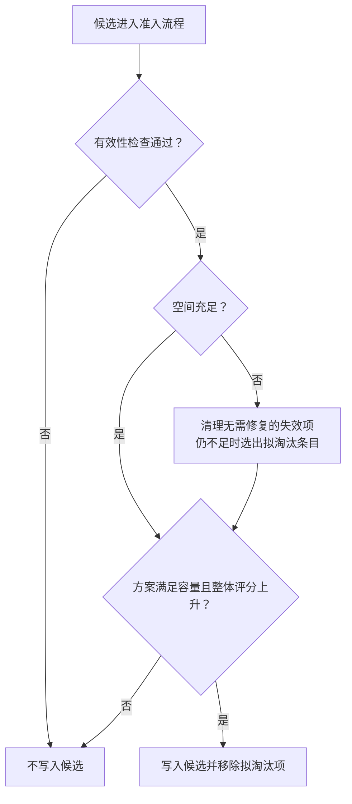
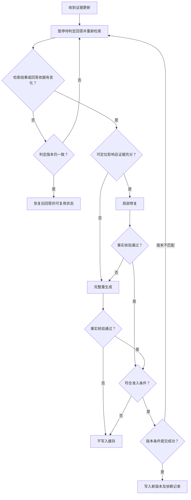

# 第一章 面向流式智能体的异质缓存机制与生命周期管理策略

> 改后初稿（第二版修订）。1.0 为绪论与相关工作的预留素材，不进入本章正文；本章正文自章首导语起。第 1.4 节给出实验设计，尚不报告策略评估结果。

## 1.0 绪论与相关工作预留素材（暂存，不放入本章正文）

### 1.0.1 流式智能体的连续服务特征

大语言模型智能体可按任务需要执行规划、外部检索、工具调用与回答生成。即使系统保留正常的会话上下文，若未对这些阶段的结果建立跨请求缓存，后续请求仍可能重复部分工作。本章考察的流式智能体是持续接收用户请求与外部更新通知的智能体服务。请求与更新可以交错到达，分别改变缓存的复用需求与有效范围。

连续运行使跨请求复用机会及其变化可被持续观测。在一定时间内，系统可能反复收到相近的查询、执行相同的只读工具调用，或使用可适配到多个请求的计划模板。与此同时，文档、数据及业务口径的变化可能使部分结果不再适用。服务过程中积累的访问、实际耗时和回退记录可用于估计复用收益，其代表性仍取决于负载与版本变化。

### 1.0.2 现有大模型与智能体缓存研究

- **推理层 KV Cache 复用。** CachedAttention、KVFlow 和 RAGCache 等工作在不同推理场景中复用或管理 Transformer 的键值状态[1–3]。基于前缀匹配的方案要求共享相同的 token 前缀；也有方法通过选择性重算复用非前缀文本块的 KV 状态，第 1.1 节提到的 Cache-Craft 属于这一类。这类方法复用模型推理状态，不直接替代应用层的检索、工具执行或规划。
- **应用层结果复用。** 语义回答缓存以历史回答为候选，通过语义匹配及质量控制减少重复生成[4,5]。相关工作也探索了工具相关信息、计划经验和工作流结果的缓存与复用[6–8]。

这些工作为相应层次或对象的复用提供了方法。本章关注多类应用层对象在同一请求路径上的收益如何计量，以及这些收益如何影响有限容量下的保留和更新决策。具体问题见第 1.1 节。

## 本章导语（章首引言）

本章所称流式智能体，是在连续服务中处理用户请求并接收外部证据或数据更新通知的智能体系统。请求与更新通知可交错到达：不同请求可能重复执行相同的规划、检索、工具调用或回答生成，外部更新则可能使先前的结果不再适用。各类结果的复用粒度、有效条件和可替代的开销不同。缓存收益取决于实际省去的工作和复用本身的开销，能否复用仍受权限、语义适用性和数据时效约束。收到更新通知后，系统还需判断哪些条目应暂停复用，以及是否值得修复。本章据此研究应用层异质缓存的复用决策与生命周期管理。

第 1.1 节分析复用机会、决策约束及缓存对象之间的依赖与收益重叠，提出研究问题并界定范围；第 1.2 节估计各类对象的时间净节省，构建综合调度评分，并设计有效性检查与回答风险门控；第 1.3 节讨论基于集合边际增益的准入与淘汰，以及单轮 `rag → resp` 链路的依赖维护与修复；第 1.4 节给出实验设计，说明如何通过事件回放和抽样执行评估所提机制；第 1.5 节总结本章。

## 1.1 问题背景与分析

在请求与外部更新交错到达的流式智能体服务中，不同请求可能触发相同或相近的执行步骤。Cache-Craft 在 Sys-X 工作负载中观察到，查询检索到的文本块约有 75% 被重复处理，因而存在重复预填充计算[9]。另一些工作报告了特定执行阶段的开销：在单张 H100 上运行 Search-R1 时，外部数据检索约占总执行时间的 40%–50%[10]；Agentic Plan Caching 在 FinanceBench 主结果配置中报告，用于规划的大模型产生的费用占该配置总费用的 94.17%[11]。在 AgenticCache 测试的具身任务中，用于规划的 LLM 调用耗时超过总运行时间的 70%[12]。这些结果分别说明了重复处理现象和特定阶段的开销，不能直接推算本章工作负载中应用层缓存可以节省的时间。

判断可节省的开销，首先需要明确缓存对象和正常执行路径。应用层缓存的内容可以是最终回答，也可以是规划、检索和工具执行的阶段性结果。结构化查询中的语义规范化与多粒度缓存是其中两类设计实例[13,14]。表 1-1 给出了本章考虑的四类缓存对象及其复用条件，并单列辅助决策的上下文与依赖状态。

**表 1-1 流式智能体中的异质缓存对象与复用条件**

| 标识 | 对象 | 缓存内容及可替代的工作 | 主要复用条件 |
|:-----|:-----|:----------------------|:-------------|
| `resp` | 最终回答 | 离线筛选的常见问题回答或在线生成的回答；直接复用可跳过本次请求原本需要的部分或全部执行阶段 | 按规范化请求精确匹配或语义召回，检查权限、上下文、请求条件及证据版本；语义候选还需经过风险判断 |
| `rag` | 检索证据 | 一次检索取得的证据块集合；条件满足时可减少或跳过完整检索 | 逐块检查权限与版本，并确认有效证据覆盖当前问题；覆盖不足时补检或执行完整检索 |
| `act` | 只读工具结果 | 外部工具或结构化查询的返回结果；可省去一次只读调用，输出字段也可能被多个下游工具使用 | 匹配工具标识、版本、规范化参数及访问范围，并核对权限和结果所依赖的数据状态 |
| `plan` | 任务计划模板 | 可绑定当前任务参数的步骤与执行路径；可减少从头规划 | 检查任务结构、前置条件、工具可用性与权限，并评估适配开销；模板通过检查后，执行仍可能需要返工或重新规划 |
| `ctx` | 上下文与依赖状态 | 会话上下文、版本快照及依赖关系；用于有效性校验和更新传播 | 不参与本章的跨请求缓存候选选择；会话上下文仍按正常流程使用 |

**当前复用的隐性开销与语义风险。** 候选被召回后，系统首先核对权限、依赖版本和适用条件。读取、校验、补检或适配都需计入复用耗时；若尝试后仍需正常执行，前期尝试还会增加开销。语义相近的回答即使通过前置检查，也可能不适用于当前请求。新条目或新版本缺少自身标注时，仅靠条目历史较难估计误复用风险。判断条目是否仍有效还须核对其依赖状态，仅凭条目年龄无法识别依赖变化。

**依赖更新与单一决策信号的局限。** 以离线分区查询为例，假设新分区于 00:00 发布，“最新”指最新已发布分区。23:58 缓存的旧分区查询结果在切换后已不适用，但如果系统只检查 1 小时的固定生存时间（time to live，TTL），这一条目在 00:05 仍可能被当作有效结果返回。另一条在 23:20 缓存的指标口径证据未被此次更新改变，却会在 00:20 因同样的 TTL 到期而退出复用。这个示例说明，仅按条目年龄设置统一固定 TTL，既可能保留已不适用的结果，也可能过早停止复用有效结果。第 1.4.1 节第（3）项的动机实验将按对象比较正常执行与复用的耗时，并记录失败尝试的回退开销；更新前后的有效复用、过期误用和不必要重算，则用于比较固定 TTL 与感知版本的策略。

> **[待补充：图 1-1 动机实验结果及定量分析]**
>
> 实验完成后，在此处插入组合图及定量分析。图 (a)、(b) 对应第 1.4.1 节第（3）项的动机实验，图 (c) 补充呈现更新的影响范围。
>
> - (a) `resp`、`plan`、`act`、`rag` 的跨请求重复情况，正常执行与成功复用的耗时，以及失败尝试后的回退开销。
> - (b) 在 18 小时主基准回放中，保持缓存容量与替换规则一致，比较统一固定 TTL 与感知版本的有效性策略，分别统计有效复用、过期误用和不必要重算。
> - (c) 在主基准的 40 个更新事件上，比较文档级失效规则标记的回答范围与经主张级核验确认受影响的回答范围。

过时信息对 RAG 的影响已有专门的评测[15]。对于可变来源上的回答缓存，已有工作通过来源版本和依赖指纹约束回答复用[16]，或估计新鲜度风险以辅助复用决策[17]。表 1-2 区分到期判断、容量分配与当前复用等决策，并归纳各类信号单独使用时的局限[2,4,18,19]。

**表 1-2 常见缓存决策信号及其局限**

| 决策信号 | 典型规则 | 对应决策与作用 | 单独使用时的局限 |
|:--------|:---------|:---------|:-----------------|
| 条目年龄 | 固定 TTL | 到期判断：根据条目年龄判定是否到期 | 不区分来源是否发生更新，可能保留旧结果或提前停止有效结果的复用 |
| 最近访问时间 | LRU | 淘汰选择：优先淘汰最久未被访问的条目 | 不核对来源版本，也不直接比较保留不同条目可节省的工作 |
| 访问频次 | LFU、访问计数 | 保留排序：优先保留访问更频繁的条目 | 不反映每次复用实际避免的开销，以及校验与回退代价 |
| 对象类型 | 固定优先级或配额 | 容量分配或排序：按对象类型设定配额或优先级 | 不反映同类条目的覆盖范围、有效性及适配成本差异 |
| 语义相似度与条目反馈 | 固定相似度阈值、逐条目风险门控 | 当前复用：用相似度初判匹配，或根据历史反馈调整复用决策 | 固定阈值难以反映风险差异；逐条目门控在新条目或新版本反馈不足时难以获得稳定估计 |

**有限容量下的集合边际收益。** 应用层缓存除了占用存储空间，还需要控制参与在线检索与更新维护的活跃条目和证据块规模。规模扩大可能增加检索与核验开销，使语义召回遇到更多表述相近但不适用的候选，并扩大外部更新后的依赖排查范围。表 1-2 所列信号各自服务于特定决策，不能直接给出新增一个条目对缓存集合的影响。准入与保留应估计该条目在未来一段时间内为集合增加的时间净节省，考虑相容请求的到达情况、条目的有效范围，以及其他缓存已提供的复用机会。若已有回答能在相同约束下为同一批请求提供等效服务，新增回答在这批请求上的边际覆盖收益为零[5]。不同类型的条目也可能节省同一段工作：直接复用最终回答时，原本需要的检索或工具执行已经被跳过，不能再将相应中间结果的命中计作同一次请求的节省；若整条回答不可复用，中间结果仍可能有价值。因此，仅按条目独立估值和排序，可能高估加入某个条目所带来的收益。准入与淘汰应在给定容量约束下比较变更前后的执行路径。

**外部更新引发的依赖维护与修复权衡。** 证据块由来源版本派生，回答中不同事实表述又可能依赖不同证据块。因而，来源更新可能只影响回答中的部分事实。这一关系与数据库物化视图的依赖维护相似，但证据到自然语言回答的生成过程通常没有可直接套用的关系增量规则。一律废弃受影响的回答并完整重生成，可能重复处理仍有证据支持的表述；局部修复则需要定位变化、复核修改和保留的事实，其总成本未必更低。无论采用局部修复还是完整重生成，写回前均需核验事实表述是否得到证据支持。提交时再核对系统已知的依赖版本，避免将处理期间因收到新版本而不再适用的结果写回。

据此，本章研究以下两个问题：

1. **异质缓存估值与当前复用决策。** 如何在计入读取、校验、适配和回退耗时后估计各类缓存的未来时间净节省，并结合对象特有的信息形成调度评分？当语义回答候选自身反馈不足时，如何权衡当前复用机会与误用风险？
2. **有限容量下的缓存调度与更新维护。** 如何根据候选条目给当前缓存集合带来的边际收益决定准入与淘汰？收到外部证据更新后，如何定位单轮 `rag → resp` 链路中受影响的回答，在局部修复与完整重生成之间选择，并避免依赖旧版本的结果写回？

**研究范围。** 本章对表 1-1 中的四类缓存对象采用统一的估值与调度框架，具体复用条件按对象区分。工具结果的跨请求复用仅针对只读调用，按调用签名、权限与数据状态检查；计划模板则检查任务前置条件和工具可用性。语义召回的回答即使通过前置检查，仍可能无法满足当前请求，因此基于反馈的风险门控用于判断这类回答候选。考虑到回答中的事实可能分别依赖不同的检索证据，事实级依赖追踪与选择性修复聚焦于单轮 `rag → resp` 短回答。评测方案结合构造请求流上的事件回放与抽样执行标定。研究对象是应用层缓存策略，不改动模型参数、推理层 KV Cache 算子或分布式存储内核，也不评估分布式流处理引擎的在线部署与集群扩展能力。

## 1.2 基于异质中间结果价值建模与有效性检查的缓存机制

### 1.2.1 面向流式智能体的异质缓存价值建模

本节以未来估值窗口内的预计时间净节省作为四类对象的共同计量基础，并结合回答的新增覆盖、证据的来源版本、工具结果的下游支撑范围和计划的执行质量构建调度评分。相关的收益建模与成本感知缓存策略见文献[5,10]。

**（1）时间净节省估计。** 设从当前估值时刻起的未来窗口长度为 \(H\)。该窗口用于预测后续收益，不决定条目的保留时长。窗口内，缓存条目 \(i\) 的基础时间净节省为：

$$
V_{\mathrm{base}}(i,H)=\widehat{N}_{i}(H)\,\overline{\Delta t}_{i}-\widehat{F}_{i}(H).
$$

- **预计有效复用次数 \(\widehat{N}_{i}(H)\)**：根据近期滑动窗口内的相容需求、条目的剩余有效期及历史选用情况估计。需求统计覆盖已复用和经正常执行满足的相容请求或执行步骤。
- **单次有效复用的平均时间净节省 \(\overline{\Delta t}_{i}\)**：用正常执行的平均耗时减去成功复用的平均耗时。成功路径计入缓存读取、有效性检查以及必要的补检或适配。
- **尝试失败后回退的预期额外耗时 \(\widehat{F}_{i}(H)\)**：用预计失败次数乘以平均额外耗时。额外耗时是“尝试后回退”的总耗时减去“直接正常执行”的耗时。例如，检查工具结果用时 30 ms，发现过期后调用工具用时 200 ms，而直接调用用时 200 ms，则额外开销为 30 ms。此项只计入尝试复用后回退所增加的时间。该估计不对已返回的错误回答等质量损失定价；权限、版本和回答质量由有效性检查、风险门控与实验指标分别处理。

**（2）类型专属价值。** 回答和证据的专属价值用于校正基础估值，工具结果和计划的专属价值分别反映依赖结构和执行质量。

| 缓存对象              | 类型专属价值               | 计算思路                                                                                                                                                                                                                                           |
| --------------------- | -------------------------- | -------------------------------------------------------------------------------------------------------------------------------------------------------------------------------------------------------------------------------------------------- |
| `resp` 回答           | 边际覆盖价值               | 对同一批近期请求回放有、无该条目的两种情况，比较该回答新增的安全复用机会及其耗时节省。已有缓存能提供同等服务时，该请求的增量为零。                                                                                                                 |
| `rag` 检索证据        | 来源版本感知的证据复用价值 | 按来源统计近期请求实际采用的证据，同一请求用到多个来源时，将一次机会分摊给这些来源。再按各来源当前版本在估值窗口内预计仍有效的时长加权，修正集合的未来复用机会。来源更新时，折减该版本对应的机会，其他来源可继续贡献。补检耗时计入单次复用净节省。 |
| `act` 只读工具结果    | 下游调用支撑价值           | 对每条结果，统计直接使用过其输出字段的不同下游工具数，同一工具重复使用只计一次。优先根据参数绑定记录确认字段来源；缺少绑定记录时，结合调用先后、字段含义和参数值推断。                                                                             |
| `plan` 任务计划模板 | 计划执行质量价值           | 根据复用该计划后的执行日志计算顺利完成率：成功完成且未发生返工、回退或重新规划的次数，除以使用该计划进入执行阶段的总次数。同时记录任务完成率和平均调整次数，分别反映完成情况和执行稳定性。                                                         |

四类专属价值的建模分别借鉴：回答缓存的逐条目风险与覆盖[4]、证据缓存的来源稳定性与新鲜度[10,17,19]、工具结果的状态依赖[6]、计划模板的适配与执行反馈[7,11]。

**`resp` 的 LLM 辅助分簇。** 按 `resp` 条目对应的请求需求分簇。系统借助 LLM 提取请求意图、关键实体、时间范围和限定条件，将表述不同但回答需求一致的请求归入同一簇，并将缓存回答关联到其原始请求所在的簇。滑动窗口内各簇的请求频次用于估计潜在复用需求；估计边际覆盖价值时，从对应簇抽取近期请求，回放有、无该回答两种情况。当前请求能否复用该回答，仍由 1.2.2 的有效性检查决定。请求意图规范化与簇划分可参考文献[20]。

**（3）综合调度评分。** 将基础时间净节省换算为无量纲分数，再结合各类对象的修正项计算综合调度评分：

$$
V_{\mathrm{final}}(i,H)=\frac{V_{\mathrm{base}}(i,H)}{T_{\mathrm{ref}}}+\phi_{\mathrm{type}}(i,H),
$$

其中，\(T_{\mathrm{ref}}>0\) 是同一估值窗口下四类对象共用的参考时长，\(\phi_{\mathrm{type}}\) 为对象类型对应的评分修正项：

| 缓存对象 | 专属修正分                                                 | 计算方法                                                                        |
| -------- | ---------------------------------------------------------- | ------------------------------------------------------------------------------- |
| `resp`   | \((V_{\mathrm{resp}}-V_{\mathrm{base}})/T_{\mathrm{ref}}\) | \(V_{\mathrm{resp}}\) 为回放有、无该条目两种情况所得的边际净节省。              |
| `rag`    | \((V_{\mathrm{rag}}-V_{\mathrm{base}})/T_{\mathrm{ref}}\)  | \(V_{\mathrm{rag}}\) 为将来源版本校正后的有效复用次数代入基础公式所得的净节省。 |
| `act`    | \(w_{\mathrm{act}}\min(d_i/D_{\mathrm{ref}},1)\)           | \(d_i\) 是该结果直接支撑的不同下游工具数，\(D_{\mathrm{ref}}>0\) 为归一化上限。 |
| `plan`   | \(w_{\mathrm{plan}}q_i\)                                   | \(q_i\in[0,1]\) 是按执行日志统计的顺利完成率，成功且未发生返工、回退或重新规划才计为顺利完成；样本不足时可参考同类计划的统计。      |

\(w_{\mathrm{act}}\) 和 \(w_{\mathrm{plan}}\) 为正权重，分别表示下游支撑范围和计划执行质量在决策中的重要程度。参考时长、归一化上限和权重在验证阶段确定，正式评估时固定。综合调度评分用于准入、保留与淘汰。评分包含未折算为时间的修正项，因此预计耗时节省单独报告；缓存容量作为第 1.3.1 节的决策约束。

请求到达和执行反馈推动滑动窗口内的估计更新；证据版本或工具依赖状态变化时，重新评估受影响条目的有效复用机会。由此得到的估值供 1.3.1 的准入、保留和淘汰使用，当前请求是否可以复用则由 1.2.2 的有效性检查决定。

### 1.2.2 基于语义与结构匹配的缓存检索与有效性检查

上一节估计缓存条目的价值，本节判断候选条目能否用于当前请求。流式智能体在回答生成、知识检索、工具调用和任务规划阶段产生不同的复用需求。为此，本节采用统一的在线流程：**按对象召回候选 → 检查候选的当前有效性 → 复用或执行原流程 → 记录反馈**。

**（1）结合语义与结构匹配召回候选。** 语义匹配用于召回表述不同但需求相近的请求、证据或计划（多向量细粒度匹配见文献[21]）；结构匹配利用工具、参数、任务阶段等字段缩小候选范围。四类对象按各自的复用粒度建立索引，检索只返回少量候选。

| 缓存对象              | 候选检索                                                                                                             | 有效性检查与处理                                                                                                                       |
| --------------------- | -------------------------------------------------------------------------------------------------------------------- | -------------------------------------------------------------------------------------------------------------------------------------- |
| `resp` 完整回答       | 优先查找规范化请求的精确键；没有可用精确候选时，按问题语义片段召回少量历史回答。                                     | 检查权限、上下文、关键实体、时间范围和限定条件，以及回答所依赖的证据版本。语义候选通过这些检查后，再以条目级风险判定回答能否直接复用。 |
| `rag` 检索证据        | 一次检索获得的证据集合为基本缓存单位。按当前问题或子需求，对证据块进行关键词和语义检索，并记录候选块所属的证据集合。 | 逐块检查权限、来源版本和时效，再判断有效证据能否覆盖当前问题。覆盖充分时用于生成；能明确定位缺失项时补检；覆盖无法确认时执行完整检索。 |
| `act` 只读工具结果    | 用工具标识、工具版本、规范化参数和数据访问范围组成调用签名，做精确匹配。                                             | 检查权限及结果依赖的数据状态；状态仍有效时复用，否则重新调用工具。                                                                     |
| `plan` 任务计划模板 | 按任务阶段和工具需求缩小范围，再按关键词和任务目标检索可适配的计划模板。                                           | 绑定当前任务的参数，检查前置条件、所需工具的可用性及权限；适配后满足条件时使用，否则重新规划。                                         |

四类对象的检索与有效性检查分别参考：回答的语义召回与风险门控[4,21,22]、检索证据的有效性核验[19]、工具调用签名与状态检查[6,10]、计划模板检索与适配[11,12,23]。

**`act` 的复用边界。** 本章只评估只读工具结果的跨请求复用。带副作用的操作不进入该策略：同一业务操作的重试应由独立的执行台账去重；对于以达成固定状态为目的的操作，是否需要再次执行应由业务逻辑根据当前目标状态判断。不同业务操作即使参数相同，也不能仅凭幂等性复用上一次的执行结果。权限隔离与缓存投毒等安全边界参见文献[24,25]，作为硬有效性门槛的设计参考。

**（2）基于版本感知的簇内反馈判断回答能否复用。** 语义候选先检查权限、请求条件和证据版本，通过后才估计误复用风险。借鉴 vCache 的逐条目在线反馈思路[4]，系统按回答条目、版本和相似度区间积累反馈，并据此设定重生成概率；回答的安全复用判断另见文献[22]。

- **新版本反馈不足时，有限借用同簇反馈。** 利用 1.2.1 的 LLM 请求簇，只从同簇其他条目借用同一相似度区间、权限范围相容且相关证据版本一致的近期标注。设候选当前版本在对应相似度区间有 \(n_i\) 条有效的自身标注，其中 \(e_i\) 条判为不匹配；兼容的同簇标注中，不匹配比例为 \(p_c\)，借用的等效样本数 \(m\) 取可借用样本数与预设上限的较小值。当 \(n_i+m>0\) 时，误复用风险的点估计为：

  $$
  \widehat p_i=\frac{e_i+m p_c}{n_i+m}.
  $$

  无兼容反馈时取 \(m=0\)，不计同簇项。给定 \(m\)，自身标注越多，借用占比 \(m/(n_i+m)\) 越小。合计样本量未达到最低要求时，执行正常生成。证据更新产生新回答版本后，从新版本开始累计自身反馈。

- **按风险随机选择复用或生成。** 样本量达标后，设 \(\delta\) 为计算重生成概率所用的误复用风险目标，\(\varepsilon\) 为最低抽样重生成概率。当 \(\widehat p_i\le\delta\) 时，以概率 \(\varepsilon\) 正常生成；当 \(\widehat p_i>\delta\) 时，以概率 \(\max\{\varepsilon,1-\delta/\widehat p_i\}\) 正常生成，其余情况直接复用。正常生成时先返回新回答，再由轻量 LLM 根据当前问题、可用证据和新回答，判断通过前置检查的旧候选是否答错、漏答或违反约束；判定明确时，将结果记入该候选的条目版本及相似度区间。

该规则以经验点估计为输入，不提供实际误复用率不超过 \(\delta\) 的保证。实验按独立真值测量实际误复用率。固定检索、标注和门控规则，比较启用与关闭簇内借用的效果，重点观察证据更新后的有效命中恢复过程及请求端时延。

**（3）在实际使用前核对依赖状态。** 流式更新可能与候选检索交错。使用已召回的条目前，系统根据上下文与依赖状态 `ctx` 中记录的当前已知版本，再次核对条目的依赖。若此时收到来源更新，`rag` 剔除受影响的旧证据块，再判断是否需要补检；依赖该来源且已失效的 `resp` 回答退出本次复用。系统记录实际采用的条目、检查结果和耗时，为 1.2.1 更新价值估计；更新事件影响哪些缓存及如何修复，由 1.3.2 处理。

## 1.3 基于价值决策与依赖感知的缓存生命周期管理策略

### 1.3.1 基于缓存价值的分层准入与淘汰机制

本节将 1.2.1 的缓存评分用于准入、保留和淘汰。四类缓存共用价值决策；回答缓存 `resp` 另设静态层和动态层，验证通过的静态回答也可申请进入动态层。

**（1）四类缓存共用的准入与淘汰。**

- **准入：** 新结果先按对象类型检查权限、版本、时效和适用条件。空间充足时，加入候选能提高缓存整体评分才准入。已有回答能为同一批请求提供同等服务时，这部分收益不重复计入。
- **淘汰：** 空间不足时，先清理已失效且无需修复的条目。仍缺空间时，按“移除造成的评分损失 ÷ 释放的空间”从低到高选出一组拟淘汰条目，直到能容纳候选；再比较替换前后的整体评分。空间满足要求且评分上升时，才执行替换。成本感知淘汰[10]、带失配代价的集合优化[5]与依赖感知淘汰[26]可作对照。
- **保留：** 用近期请求和实际复用反馈更新评分，调整有效条目的保留顺序。依赖更新导致的失效与修复由 1.3.2 处理，修复后的新版本通过检查后重新参与准入。

设当前有效缓存集合为 \(M\)，候选条目为 \(i\)，拟淘汰集合为 \(E\)（空间充足时为空）。在同一估值窗口 \(H\) 内，比较：

$$
\Delta S=S\bigl((M\setminus E)\cup\{i\},H\bigr)-S(M,H).
$$

集合评分 \(S\) 沿用第 1.2.1 节的计量口径，在同一批代表性请求上比较替换前后的执行路径。同一次请求中实际避免的工作只计一次，再按同节的权重计入工具结果的下游支撑和计划的执行质量。拟淘汰集合由启发式规则给出；当变更满足容量约束且 \(\Delta S>0\) 时，才接受该准入或替换方案。

*图：四类缓存共用的准入与淘汰流程。*

**（2）`resp` 的静态层与动态层提升。** 参考 Krites 的双层回答缓存与异步验证思路[18]，两层分别保存：

| 层级   | 保存内容                                                             |
| ------ | -------------------------------------------------------------------- |
| 静态层 | 离线筛选的完整回答。                                                 |
| 动态层 | 按本节规则准入的在线回答，以及已验证的请求签名到静态回答版本的映射。 |

1. **先完成当前请求。** 静态回答满足 1.2.2 的复用条件时可直接返回；若相关但适用性暂不能确认，当前请求继续查动态层，未命中则正常生成。
2. **再验证静态候选。** 当前请求完成后，对已通过权限、时效和版本初检的静态候选，使用轻量 LLM 判断它是否满足本次请求；有可比的新回答时，可一并作为参考。
3. **通过后重新估值。** 写入前复核依赖版本，按通用规则比较新增映射的价值与占用空间。满足条件时写入动态层，映射绑定已验证的请求条件、权限范围和依赖版本；后续请求仍按 1.2.2 检查。

### 1.3.2 面向流式更新的依赖传播与缓存修复策略

RAG 依赖的外部资料会随时间新增、修改或删除，这些变更以更新事件的形式持续进入流式智能体系统，形成证据更新流。更新事件可能在系统处理请求或修复缓存时到达，因此，证据更新与请求处理、缓存修复会在时间上交错。本节聚焦单轮 `rag → resp` 的短回答，依次完成**记录依赖、定位影响、选择修复方式、核验写回**，在系统已知的证据版本下管理缓存回答的可用性。可变文档上的依赖一致答案复用见文献[16]，新鲜度风险与刷新调度对陈旧的影响见文献[17,27]。

**（1）生成时记录事实与证据的依赖。** 缓存回答时保存原问题、检索配置和 Top-k 证据，并在 `ctx` 中记录索引版本以及“**来源版本 → 证据块 → 回答中的事实表述**”的依赖关系。借助反向索引，系统能从变更证据定位到受影响的回答及具体表述；证据与表述的对应关系不清时，该回答走完整重生成路径。依赖感知的失效传播参考多智能体缓存的 DAG 依赖建模[26]与可变文档答案复用[16]。

**（2）更新时定位影响并暂停旧回答复用。** 收到证据新增、修改或删除事件后，先暂停尚未判定影响的缓存回答。首版用固定的确定性检索器对缓存查询完整重检，对比新旧 Top-k 的证据 ID、内容版本或哈希及排序。这样也能发现新进入 Top-k 的证据。检索结果与回答依据均未变化、且用于判定的版本仍是系统当前已知版本时，恢复条目的可复用状态；发生变化时，结合证据差异与依赖记录定位受影响的表述。

**（3）根据影响范围选择局部修复或完整重生成。** 将原问题、旧回答、证据变更及更新后的相关证据交给轻量 LLM，判断影响范围并提出修复候选（证据驱动的文本修订参考 RARR[28]）：

| 条件                                                     | 处理方式                                           |
| -------------------------------------------------------- | -------------------------------------------------- |
| 影响限于可定位的事实，替代证据充分，其余表述仍有证据支持 | 只修改受影响的表述。                               |
| 影响范围不清、整体推理发生变化、溯源不清或缺少充分证据   | 基于最新证据完整重生成；仍无法确认时说明证据不足。 |

**（4）核验回答，再按版本条件写回。** 逐条核验候选回答中的事实，包括修改和保留的表述（细粒度主张核验与幻觉标注参考 RAGTruth[29]）。局部修复未通过核验时，回退到完整重生成。完整重生成的结果若仍未通过核验，则不进入缓存。通过核验的候选及其依赖记录先按第 1.3.1 节评估准入。满足准入条件后，将索引版本和来源版本的核对与写入合并为一次条件提交；若当前已知版本已不匹配，则不写入旧候选，按最新版本重新定位。待修复的旧回答保持不可复用。

*图：证据更新后的影响定位、修复与版本条件提交。*

例如，活动公告将开始时间从 **10:00 改为 10:30**，地点和入场规则的依据仍有效，系统只修改时间，再核验整条回答。若提交前系统又收到公告改为 **11:00** 的更新，10:30 的修复结果不能写入缓存，需按新版本重新处理。

该方法与完整重生成、轻量 LLM 直接改写的对比见 1.4.5。

## 1.4 实验评估与分析

本节给出实验设计。四项评估以同一智能取数实验台为基础，分别考察复用决策、容量受限时的保留策略、证据更新后的修复代价，以及完整方案的端到端表现。主基准采用同一构造请求流；涉及不同更新强度的补充回放单独报告。

### 1.4.1 实验设置

**（1）离线回放与抽样执行标定。** 实验按系统收到请求、更新通知或任务反馈的顺序回放事件[30]。无缓存基线关闭本章的四类应用层缓存，保留正常会话上下文，并与其他方法使用相同的请求和外部状态。

- **离线回放：** 预先计算无缓存执行结果，准备候选复用的标注和各阶段成本。策略在回放时只读取当时已到达的事件；候选标注仅按被评估策略实际触发的重生成或核验流程向策略披露，不将评估真值作为决策输入。
- **执行标定：** 计划抽取 300 条构造请求，实际执行相应路径，标定其时延与成本；在独立验证样本上比较回放估计和实际执行时延，并报告平均绝对百分比误差（MAPE）。全量回放的时延为建模结果，抽样执行的实测结果另行报告。本地阶段已进行部分标定，尚未完成模型路径标定。

**（2）数据与规模。** 主基准包含 2,000 篇带版本文档、3,000 条构造的单轮请求及 40 个更新事件；当前数据池含 100 个只读工具结果候选与 60 个计划模板。请求、到达过程和更新事件由受控实验台构造，不代表生产用户流量。评估真值独立于模型判官：数值事实依据对应快照上的参考查询结果，口径及证据支持依据版本化指标卡和事实标注，工具结果与计划执行分别对照规则和任务参考路径。模型判官用于风险估计和候选回答核验，其判断与人工复核的一致性另行报告。工具与任务环境的设计参考 AgentBench[31]、WebArena[32]、ToolBench[33]、StableToolBench[34] 和 WebShop[35]，不将其报告结果作为本章的实验结果。

**（3）动机实验口径。** 按对象比较正常执行与成功复用的耗时，计入读取、核验、补检或适配，并单独记录失败尝试后的回退开销。针对更新前后的请求，在相同缓存容量与替换规则下，比较统一固定 TTL 与感知版本的有效性策略，区分有效复用、过期误用和不必要重算。该实验用于检验第 1.1 节讨论的复用空间与固定 TTL 的局限，不以阶段耗时占比代替可节省的时间。

**（4）指标。** 主要指标反映复用质量、时延与开销；诊断指标用于解释回退、修复和替换的影响。

| 指标 | 定义 |
|:-----|:-----|
| 回答正确率 | 判定为正确的回答数除以总回答数 |
| 质量约束 | 相对无缓存基线允许的回答正确率下降，单位为百分点 |
| P95 时延 | 单请求端到端时延的第 95 百分位数 |
| 推理成本 | 按统一计费口径核算的模型及相关执行开销，计入后台模型调用 |
| 安全复用率 | 实际复用了缓存且按真值判定复用有效、结果达标的请求数除以总请求数 |
| 回答误复用率 | 实际复用了缓存回答但按独立真值不适用或不正确的请求数除以总请求数；另报告在已复用回答中的占比 |
| 修复成本 | 更新后影响定位、重检、生成、核验和回退所产生的总开销；同一工作不重复计入 |
| goodput | 单位回放时间内满足质量与时延目标（SLO）的请求数 |

**（5）评测边界。** 本实验不评估跨硬件或分布式系统的扩展性。在线决策以系统已收到的更新为准；评估旧结果是否仍适用时，按数据实际生效的版本判定。分别检查越权复用、已知失效后继续复用及通知前发生的过期误用。如果主基准未覆盖“版本已生效但系统尚未收到更新”的请求，不用零违规推断该时段不存在风险。策略对比使用本章实验台的测量结果，不直接比较其他论文在不同负载下报告的数字。

### 1.4.2 实验检验问题

- **C1 复用决策。** 在相同回答质量约束下，不同复用策略的 P95 时延、推理成本与安全复用率有何差异？簇内反馈借用能否帮助新版本更快恢复有效命中？
- **C2 容量受限。** 在相同候选集、有效性门槛和容量约束下，依据集合边际评分的策略与 LRU、LFU、GDSF 在安全复用、时延和成本上有何差异？
- **C3 更新与修复。** 与完整重生成及直接改写相比，选择性修复在计入影响定位、重检、核验和回退后，具有怎样的成本与质量表现？这种表现如何随更新影响范围变化？
- **C4 整体收益。** 与无缓存、预先选定的单机制配置以及去掉单一组件的配置相比，完整方案在有效请求处理速率、时延、总成本和正确率上有何差异？

### 1.4.3 实验一：复用决策（C1）

以相对无缓存基线允许的正确率下降为质量约束，分别考察 1、3、5 个百分点三个约束点。各方法使用相同的候选、前置检查和标注口径，在独立验证回放上选取配置，再到测试回放上报告质量与时延；未达到质量约束的结果单独标记。

| 项目 | 内容 |
|:-----|:-----|
| 对比 | 全局相似度阈值、基于 vCache 逐条目反馈思路的门控基线、本文方法；另比较关闭簇内借用的配置 |
| 指标 | P95 时延、推理成本、回答正确率、安全复用率、回答误复用率 |
| 主图 | 质量与时延的权衡曲线；证据更新后有效命中的变化 |

在主基准上评估各策略，并单列更新后新版本自身标注较少的请求，观察有效命中随反馈积累的恢复过程。该分组用于检验簇内借用在反馈稀疏时的作用；同时保留全流量结果，以检验整体表现。只读工具结果与计划模板的复用另报告任务成功率和时延，不混入回答门控的消融。

### 1.4.4 实验二：容量受限（C2）

容量取工作集容量的 10%、25%、50% 三点。LRU、LFU、GDSF 与本文策略共用候选集、有效性门槛和成本估计。在比较保留策略时固定回答缓存的层级设置，另对静态层配置做开关对照。

| 项目 | 内容 |
|:-----|:-----|
| 对比 | LRU、LFU、GDSF、本文方法 |
| 指标 | 安全复用率、P95 时延、累计成本、准入与淘汰次数 |
| 主图 | 容量与收益曲线；回答缓存静态层开关的对照 |

主实验采用逻辑容量单位：每个 `resp`、`act`、`plan` 条目计 1 个单位，`rag` 按所含证据块数计。该口径用于比较给定容量约束下的策略行为，不代表各类条目具有同样的物理存储开销。

### 1.4.5 实验三：更新与修复（C3）

在主基准的 40 个更新事件上，评估单轮 `rag → resp` 短回答的维护策略。以更新事件与受检回答的配对为统计单位，分别观察未受影响、影响可局部定位和需要完整重生成的情形。计划另构造不同更新率的补充回放，分别报告实际事件数与受检回答数；更新事件的设计参考 ChurnBench[27]。

| 项目 | 内容 |
|:-----|:-----|
| 对比 | 完整重生成、轻量 LLM 直接改写、本文依赖定位与选择性修复 |
| 指标 | 整体修复成本及分项、修复期间 P95 时延、事实正确率、证据支持率、局部修复回退率 |
| 主图 | 质量与成本的对照；重检、生成、核验等开销的分解 |

各方法根据同一批输入、同一版本的资料和同一评估真值比较。选择性修复若经核验失败并回退，其首次修复和后续重生成的开销均计入总成本。根据证据及事实表述的变化范围，分析定位和核验开销是否抵消生成阶段的节省。

### 1.4.6 实验四：整体收益（C4）

在含更新事件的混合负载上比较完整方案与对照配置。所报告的结论限于实际参与对比的配置。

| 项目 | 内容 |
|:-----|:-----|
| 对比 | 无缓存、预先选定的单机制配置、完整方案、分别关闭单一组件后的完整方案 |
| 指标 | goodput、P95 时延、总成本、回答正确率 |
| 主图 | 各配置的主要指标；更新事件前后的时延和有效复用变化 |

消融分别移除 `act` 类型修正项、`plan` 类型修正项、选择性修复和簇内反馈借用，观察各项机制对端到端表现的影响。

### 1.4.7 结果讨论

实验完成后，重点报告不同容量、更新强度和请求重复度下的表现，分析效果持平或下降的条件。讨论回放估计与实测时延的差异，以及由具体构造规则、版本通知方式和任务范围带来的适用边界。

## 1.5 本章小结

本章以连续服务中的应用层结果为研究对象，区分了当前请求的复用判断、有限容量下的保留决策，以及证据更新后的缓存维护。针对四类对象，本文以时间净节省作为共同计量基础，并结合对象特征构建综合调度评分；针对当前复用，引入按对象的有效性检查与回答风险门控。在生命周期管理中，准入与淘汰以集合边际增益为依据；证据更新后的选择性修复限于单轮 `rag → resp` 链路。第 1.4 节给出了检验这些机制的对照设计。

## 参考文献

下列文献按本稿首次引用的顺序编号。将第 1.0 节的预留素材移出后，文献编号随论文全文统一调整。预印本已标注，书目信息可参照《第一章_参考文献汇总.xlsx》。

[1] Gao B, He Z, Sharma P, et al. Cost-Efficient Large Language Model Serving for Multi-turn Conversations with CachedAttention[C]//Proceedings of the 2024 USENIX Annual Technical Conference (ATC). 2024.

[2] Pan Z, Patel A, Hu Z, et al. KVFlow: Efficient Prefix Caching for Accelerating LLM-Based Multi-Agent Workflows[C]//Advances in Neural Information Processing Systems 38 (NeurIPS). 2025. arXiv:2507.07400.

[3] Jin C, Zhang Z, Jiang X, et al. RAGCache: Efficient Knowledge Caching for Retrieval-Augmented Generation[J]. ACM Transactions on Computer Systems, 2026, 44(1): 1-27. DOI: 10.1145/3768628.

[4] Schroeder L G, Desai A, Cuadron A, et al. vCache: Verified Semantic Prompt Caching[C]//International Conference on Learning Representations (ICLR). 2026. arXiv:2502.03771. https://iclr.cc/virtual/2026/poster/10006471.

[5] Liu X, Atalar B, Dai X, et al. Semantic Caching for Low-Cost LLM Serving: From Offline Learning to Online Adaptation[C]//IEEE INFOCOM 2026—IEEE Conference on Computer Communications. IEEE, 2026: 1-10. DOI: 10.1109/INFOCOM59046.2026.11571467.

[6] Kumar A V, Kataria B, Oh B, et al. TVCACHE: A Tool-Value Cache for Post-Training LLM Agents[C]//Proceedings of the 43rd International Conference on Machine Learning. PMLR, 2026, 306: 61539-61558. https://proceedings.mlr.press/v306/kumar26d.html.

[7] Fan S, Cong X, Zhang Z, et al. Generalizing Experience for Language Agents with Hierarchical MetaFlows[C]//Advances in Neural Information Processing Systems 38 (NeurIPS). 2025. https://proceedings.neurips.cc/paper_files/paper/2025/hash/5c882988ce5fac487974ee4f415b96a9-Abstract-Conference.html.

[8] Begum F, Scott C, Nyarko K, et al. Hierarchical Caching for Agentic Workflows: A Multi-Level Architecture to Reduce Tool Execution Overhead[J]. Machine Learning and Knowledge Extraction, 2026, 8(2): 30. DOI: 10.3390/make8020030.

[9] Agarwal S, Sundaresan S, Mitra S, et al. Cache-Craft: Managing Chunk-Caches for Efficient Retrieval-Augmented Generation[C]//Proceedings of the 2025 ACM SIGMOD International Conference on Management of Data. 2025. arXiv:2502.15734.

[10] Ruan C, Bi C, Zheng K, et al. Cortex: Achieving Low-Latency, Cost-Efficient Remote Data Access for LLM via Semantic-Aware Knowledge Caching[C]//23rd USENIX Symposium on Networked Systems Design and Implementation (NSDI). USENIX Association, 2026: 2407-2421. https://www.usenix.org/conference/nsdi26/presentation/ruan-cortex.

[11] Zhang Q, Wornow M, Olukotun K. Agentic Plan Caching: Test-Time Memory for Fast and Cost-Efficient LLM Agents[C]//Advances in Neural Information Processing Systems 38 (NeurIPS). 2025. https://proceedings.neurips.cc/paper_files/paper/2025/hash/9549f7d06700f0966d5f938f1d11022a-Abstract-Conference.html.

[12] Kim H, Wu Y, Tambe T. AgenticCache: Cache-Driven Asynchronous Planning for Embodied AI Agents[C]//Proceedings of Machine Learning and Systems (MLSys). 2026. https://mlsys.org/virtual/2026/poster/3583.

[13] Bindschaedler L. Semantic Caching for OLAP via LLM-Based Query Canonicalization[EB/OL]. arXiv:2602.19811, 2026.（DOLAP 2026 短文扩展版）

[14] Lee M, Yang H, Kim M S. TierCache: A Multi-Granularity Semantic Caching Framework for Structured Query Generation[C]//Conference on Language Models (COLM). 2026.

[15] Ouyang J, Pan T, Cheng M, et al. HoH: A Dynamic Benchmark for Evaluating the Impact of Outdated Information on Retrieval-Augmented Generation[C]//Proceedings of the 63rd Annual Meeting of the Association for Computational Linguistics (Volume 1: Long Papers). 2025. https://aclanthology.org/2025.acl-long.301/.

[16] Zeng L, Jin Y. FinCacheServe: Dependency-Consistent Answer Reuse for Cost-Efficient RAG Serving over Mutable Enterprise Documents[EB/OL]. arXiv:2607.26076, 2026. https://arxiv.org/abs/2607.26076.（预印本）

[17] Mansoor M, Ahmad T, Yoon Y C. Risk-Constrained Freshness-Aware Semantic Caching for Open-Web Retrieval-Augmented LLMs[EB/OL]. arXiv:2607.04281, 2026. https://arxiv.org/abs/2607.04281.（预印本）

[18] Singh A K, Wang H, Attaluri L N S, et al. Asynchronous Verified Semantic Caching for Tiered LLM Architectures[C]//Proceedings of the Sixth European Workshop on Machine Learning and Systems (EuroMLSys). 2026: 192-199. DOI: 10.1145/3805621.3807627.

[19] Verma A, Pillai S, Das S, et al. Safe and Sufficient Caching: Validated Evidence Reuse for Production Retrieval-Augmented Generation[C]//Proceedings of the 2026 Conference on Empirical Methods in Natural Language Processing: Industry Track. 2026: 1272-1279. DOI: 10.18653/2026.emnlp-industry.75.

[20] Basu A. Why Agent Caching Fails and How to Fix It: Structured Intent Canonicalization with Few-Shot Learning[EB/OL]. arXiv:2602.18922, 2026. https://arxiv.org/abs/2602.18922.（预印本）

[21] Noshad A, Zheng Z, Wu Y. MVR-cache: Optimizing Semantic Caching via Multi-Vector Retrieval and Learned Prompt Segmentation[C]//International Conference on Machine Learning (ICML). 2026. arXiv:2605.24914. https://icml.cc/virtual/2026/poster/63545.

[22] Liang J, Wang Y, Jiang T, et al. LaCache: Robust Semantic Caching for LLM Serving[C]//Advances in Neural Information Processing Systems (NeurIPS). 2026. arXiv:2608.01718. https://neurips.cc/virtual/2026/poster/152812.

[23] Chillara V, Kline D, Alvares C, et al. SemanticALLI: Caching Reasoning, Not Just Responses, in Agentic Systems[EB/OL]. arXiv:2601.16286, 2026. https://arxiv.org/abs/2601.16286.（预印本）

[24] Wu G, Wang T, Zhang Y, et al. When Cache Poisoning Meets LLM Systems: Semantic Cache Poisoning and Its Countermeasures[C]//Proceedings 2026 Network and Distributed System Security Symposium (NDSS). 2026. DOI: 10.14722/ndss.2026.240200.

[25] Zhang Z, Liu Z, Xie Y, et al. From Similarity to Vulnerability: Key Collision Attack on LLM Semantic Caching[C]//International Conference on Machine Learning (ICML). 2026. arXiv:2601.23088. https://icml.cc/virtual/2026/poster/65663.

[26] Mohamed A, Haque K, Khan A A, et al. Workload-Aware Caching for Multi-Agent Systems[EB/OL]. arXiv:2607.20495, 2026. https://arxiv.org/abs/2607.20495.（预印本）

[27] Singh V K, Priyam P, Bhowmick G. ChurnBench: A Drift-Aware Benchmark Demonstrating That Refresh Scheduling, Not Cache Age, Governs Staleness in Agentic AI[EB/OL]. arXiv:2609.11515, 2026. https://arxiv.org/abs/2609.11515.（预印本）

[28] Gao L, Dai Z, Pasupat P, et al. RARR: Researching and Revising What Language Models Say, Using Language Models[C]//Proceedings of the 61st Annual Meeting of the Association for Computational Linguistics (Volume 1: Long Papers). 2023. https://aclanthology.org/2023.acl-long.910/.

[29] Niu C, Wu Y, Zhu J, et al. RAGTruth: A Hallucination Corpus for Developing Trustworthy Retrieval-Augmented Language Models[C]//Proceedings of the 62nd Annual Meeting of the Association for Computational Linguistics (Volume 1: Long Papers). 2024. https://aclanthology.org/2024.acl-long.585/.

[30] Apache Software Foundation. Apache Flink Documentation: Stateful Stream Processing (Release 1.20)[EB/OL]. [2026-11-18]. https://nightlies.apache.org/flink/flink-docs-release-1.20/.

[31] Liu X, Yu H, Zhang H, et al. AgentBench: Evaluating LLMs as Agents[C]//International Conference on Learning Representations (ICLR). 2024. arXiv:2308.03688. https://github.com/THUDM/AgentBench.

[32] Zhou S, Xu F F, Zhu H, et al. WebArena: A Realistic Web Environment for Building Autonomous Agents[C]//International Conference on Learning Representations (ICLR). 2024. arXiv:2307.13854. https://github.com/web-arena-x/webarena.

[33] Qin Y, Liang S, Ye Y, et al. ToolLLM: Facilitating Large Language Models to Master 16000+ Real-world APIs[C]//International Conference on Learning Representations (ICLR). 2024. arXiv:2307.16789. https://github.com/OpenBMB/ToolBench.

[34] Guo Z, Cheng S, Wang H, et al. StableToolBench: Towards Stable Large-Scale Benchmarking on Tool Learning of Large Language Models[C]//Findings of the Association for Computational Linguistics: ACL 2024. 2024: 11143-11156. DOI: 10.18653/v1/2024.findings-acl.664.

[35] Yao S, Chen H, Yang J, et al. WebShop: Towards Scalable Real-World Web Interaction with Grounded Language Agents[C]//Advances in Neural Information Processing Systems 35 (NeurIPS). 2022. arXiv:2207.01206. https://webshop-pnlp.github.io.
