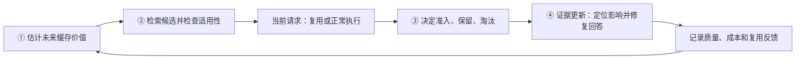
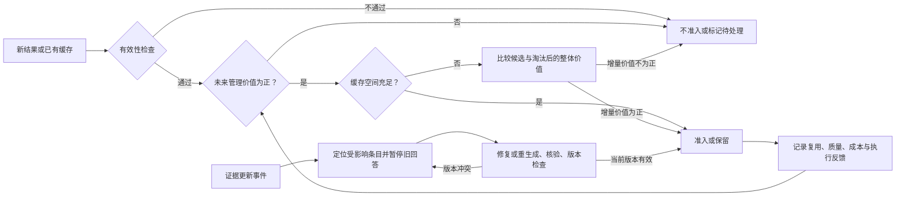
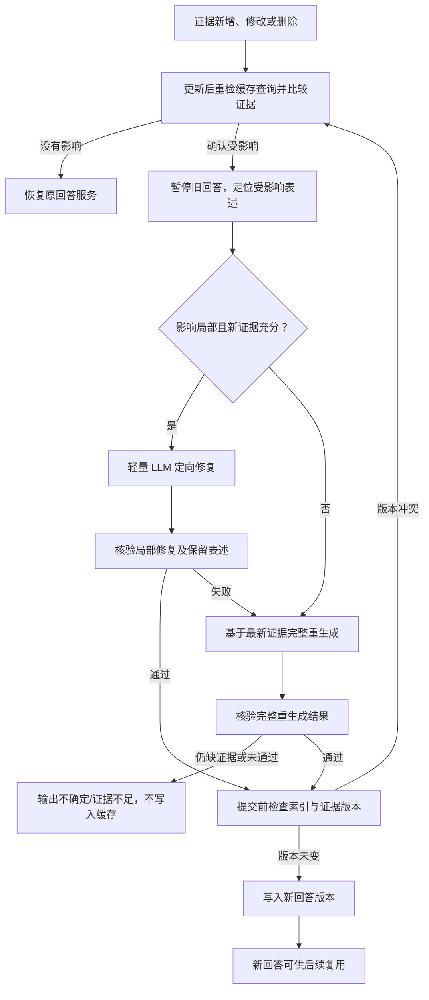

# 第一章研究设计（简）

## 这一部分想解决什么？

流式 Agent 会持续处理请求，检索证据、生成回答和调用工具；外部知识也会不断变化。缓存能减少重复工作，但只有在内容仍适用、值得保留时才有价值。本研究围绕两个问题展开：**缓存未来能够带来多少收益？缓存内容如何随需求和证据变化而管理？**

研究对象包括四类缓存：`resp`（回答）、`rag`（检索证据）、`act`（只读工具结果）和 `plan`（可迁移的计划模板）。

## 两大研究点、四个小点

| 研究点 | 小点 | 要回答的问题 |
|---|---|---|
| 一、缓存价值建模与检索复用 | ① 异质对象的价值建模 | 这条缓存未来可能带来多少有效收益？ |
|  | ② 候选检索与有效性检查 | 当前请求能否安全使用这条缓存？ |
| 二、缓存生命周期管理 | ③ 价值驱动的准入、保留与淘汰 | 哪些结果值得进入和留在缓存？ |
|  | ④ 面向证据更新的依赖传播与自适应修复 | 更新后哪些回答受影响，如何恢复有效？ |

### ① 估计不同缓存的未来价值

以近期请求、实际节省的时间与成本、内容有效期和依赖状态，估计缓存未来窗口内能提供的有效复用收益。

| 对象 | 价值主要来自 | 关键有效性条件 |
|---|---|---|
| `resp` | 少做一次回答生成 | 问题适配、权限、证据与内容版本仍有效 |
| `rag` | 少做检索、回源和证据加工 | 来源版本有效，证据覆盖当前问题 |
| `act` | 少做一次只读工具调用 | 工具、参数、权限及依赖数据状态兼容 |
| `plan` | 少做规划和重规划，并改善执行阶段表现 | 任务阶段、前置条件和工具仍适配；记录执行回退与任务完成反馈 |

价值用于比较“保留缓存”和“重新执行”的预期差异；质量、时间和资源开销分别记录，避免把不同单位直接相加。

### ② 找到候选并检查能否复用

先按对象特点检索少量候选，再检查权限、版本、时效和任务适配性。通过检查的结果才进入当前请求的复用路径；`rag` 证据不完整时，只复用有效部分并补检缺失内容。实际结果及开销回流到价值估计。

### ③ 用价值管理缓存生命周期

新结果先检查有效性，再结合未来价值决定是否准入。容量不足时，比较候选进入、已有条目移除前后的整体收益，淘汰保留收益较低的条目，并随请求热度、缓存年龄和依赖变化重新评估。

对静态 `resp`，请求落在适用性灰区时，当前请求先正常完成，后台再验证静态回答；验证通过后，只有预计未来收益为正才提升到动态缓存。

### ④ 证据更新后定位影响并修复回答

回答生成时记录“来源版本 → 检索证据 → 回答事实表述”的对应关系。收到证据新增、修改或删除事件后，首版对缓存查询使用固定检索器在更新后的索引上重检，比较新旧证据 ID、内容版本和排序。影响判断期间暂停相关旧回答；判断无影响后才恢复服务。

**例子：**缓存回答为“故障在 10:00 开始，原因是配置错误”。公告将时间更正为 10:30，原因证据未变。系统定位到时间表述，轻量模型只修改该处；核验通过且提交前版本仍最新后，写入新回答。如果修复期间公告再次更新，系统丢弃旧候选，基于最新证据重新定位，再判断局部修复或完整重生成。证据不足时明确表示不确定，不补造事实。

## 实验准备

首版回答修复实验聚焦**单轮 `rag → resp`、短回答、可追溯证据和固定确定性检索器**。来源更新的通知延迟与系统接收更新后的处理延迟分别记录。

| 实验 | 对比内容 | 主要观察指标 |
|---|---|---|
| 价值建模 | 本文估值与频率、LRU 等简单基线 | 估值误差、有效复用收益、误用风险 |
| 生命周期 | 价值驱动准入/淘汰与 LRU、LFU、成本感知策略；静态回答验证提升与不提升 | 固定容量下的质量、时延、淘汰与维护开销 |
| 更新后回答修复 | ① 完整重生成；② 直接交给轻量 LLM 修复；③ 依赖定位、局部修复或重生成并核验 | 正确率、证据支持率、陈旧回答暴露率及时间、修复/回退比例、总时延与调用成本 |

更新实验覆盖无关变化、证据新增、修改、删除、无替代证据和修复期间再次更新。三种策略都计入更新后缓存查询的完整重检成本；按各自实际流程计入修复、核验及失败后重生成成本。回答质量由独立标注或程序化真值评估，不用修复模型自己的判断证明正确。

## 相关工作提供什么依据？

- [StreamRAG（CVPR 2026）](https://openaccess.thecvf.com/content/CVPR2026/papers/Xie_StreamRAG_Enhancing_Real-Time_Video_Understanding_with_Retrieval_Augmentation_CVPR_2026_paper.pdf)：实时流数据进入检索知识库的场景背景。
- [HoH（ACL 2025）](https://aclanthology.org/2025.acl-long.301/)：知识随时间变化时的 RAG 过时回答评测。
- [RARR（ACL 2023）](https://aclanthology.org/2023.acl-long.910/)：用检索证据修订生成文本。
- [RAGTruth（ACL 2024）](https://aclanthology.org/2024.acl-long.585/)：RAG 回答细粒度事实支持与错误评估参考。

这些工作分别支撑流式更新场景、过时信息评测、证据驱动修订和回答核验；本研究提出的缓存依赖定位、修复/重生成分流及版本提交组合，仍需由上述实验验证。
